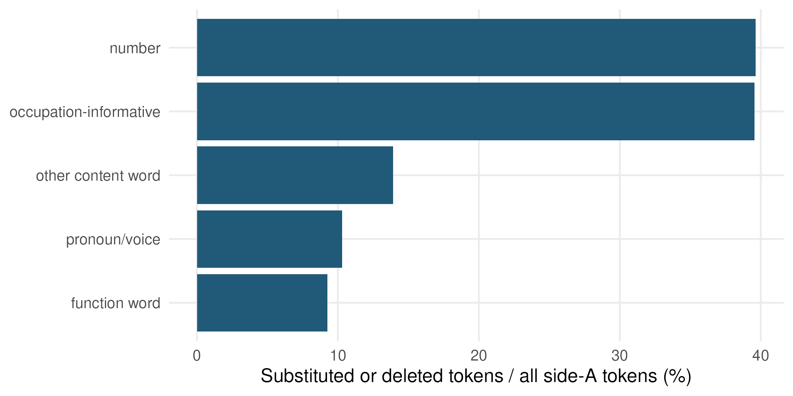

# Appendix A. Sample, Collection, and Metadata {.unnumbered}

## A1. Collection Scope and Inclusion

The collection used public Upwork profile-detail endpoints in a single run on September 21, 2023.
Identifiers were assembled from Upwork's public category pages and deduplicated.
Because a single listing returns a capped number of results, the listings were partitioned by further filters, such as country and rate group, with the aim of retrieving every public profile.
The identifier-extraction script traverses occupational categories, subcategories, occupations, rate groups, and, in one stored structure, regions.
Work-history retrieval is not part of this project.
Completeness cannot be verified against the platform's own records, so the present analysis concerns the retrieved-profile cross-section rather than a demonstrated census of the public market.

The identifier list held  unique identifiers after removing  duplicate rows.
Each identifier received one saved response.
 responses () contained an error message instead of a profile:  reported that the profile was no longer available and  that it could not be found.
These contain no profile text or metadata and are excluded, leaving the  usable records that form the analysis input.

The input contains  rows.
To reconstruct the original sentence identifiers, we preserve the original common-vocabulary filtering and row order.
A worker is retained if their description contains at least one non-stopword token without digits that occurs more than 100 times across the input.
This criterion retains  profiles.
It excludes descriptions without a qualifying common token but does not certify that all retained texts are English.
Profiles without a qualifying 8–50-word sentence are excluded from the reuse frame, leaving  workers.
The main sample-flow table separates that frame from the identifying sample of Model 1 and the rate sample of Model 2.

Model 2 restricts posted USD hourly rates to 3–500 and requires the existing age covariate.
 workers meet these conditions.
The age restriction is retained to match the original estimated specification.
Completed jobs and recorded hours supply the platform-experience controls; the age spline is a separate timestamp-derived control.





Descriptive statistics are unweighted summaries of the Model 2 frame.
They do not characterize every registered worker or correct selection into public accessibility.
Workers can list several occupations; the first-listed occupation is an operational primary category, not a complete competence inventory.
Country and city are retained profile metadata, not inferred demographics.

## A2. Timing and Record Semantics

The author confirmed that `created_at` and `updated_at` concern creation and editing of the profile description.
Their meanings should not be conflated with account registration, first employment, or timestamps for individual sentences.
The reference date used by the existing pipeline is the latest observed update, September 8, 2023.
This supplies a reproducible anchor for the age covariate.
Profiles were retrieved thirteen days later, on September 21, 2023, so the anchor is the last observed update, not the retrieval date.

The legacy computational variable `tenure_yrs` is calculated as

$$
\frac{\text{latest observed description update}-\text{description creation}}{365.25\text{ days}}.
$$

We describe this variable as description/profile age, not worker tenure.
Model 2 includes a five-degree-of-freedom natural spline of that age in addition to completed-job groups and log jobs/hours.
Retaining it does not change the interpretation of the experience controls.

The flag `text_dated` is true when the observed update–creation gap is at most one day.
The existing outputs call these profiles “never-edited.”
The more precise description is a *within-one-day edit subset*: the flag permits changes during that interval and does not demonstrate that the text preceded all completed work.
There are  such profiles in the reuse frame.
The timing sensitivity uses their observed current text and current metadata, not a longitudinal reconstruction of work history.
The flag defines this robustness subset and the creation-month descriptions; it is not a control variable in Model 1 or Model 2.

Completed-job totals, work hours, and rating fields are platform-recorded metadata.
Statements inside a description about years of experience, client histories, hours, ratings, or qualifications are textual claims and are not automatically verified by those fields.
The qualitative record-reference code is therefore not an alternative measurement of the platform record.

## A3. Safeguards and Publication Materials

The publication uses aggregate statistics, short quotations of passages that recur across workers, which do not by themselves single out any individual, and paraphrases of personal material.
It does not reproduce platform identifiers or publish complete descriptions, client names, the internal case codes, or the coding readers.

Public availability does not settle permission for redistribution.
Reproducibility documentation should distinguish public analytical code and aggregate results from restricted source texts and identifiers.

# Appendix B. Detection and Measurement Details {.unnumbered}

## B1. Text Preparation, Shingles, and Validation

Descriptions are normalized for newlines and repeated whitespace.
A sentence tokenizer is applied to the normalized text.
Eligibility is determined by counting non-whitespace sequences: at least eight and at most 50.
Sentences are lowercased but stopwords and numbers are not removed from the comparison text.
The original worker order, sentence order, and filter are preserved to reconstruct stable sentence identifiers.

The sentence corpus contains  units.
Each is represented as the set of its contiguous word five-grams using the text-reuse tokenizer.
This comparison tokenizer is distinct from the whitespace count used to select sentences and from the word tokenizer used for specificity and numerical-content measures.
The resulting Jaccard coefficient measures overlap between shingle sets, not similarity between full descriptions.

MinHash uses 240 permutations, with seed 456 in the original detection script; LSH uses 60 bands and four rows per band.
Exact Jaccard scores are computed for the returned candidates.
The detection step yields  scored candidate pairs, of which  concern sentences from the same worker and are dropped.
A seeded reconstruction check re-computed 3,000 stored pair scores from rebuilt sentences.
All agreed within $10^{-9}$.
This is an implementation and identifier check; it does not establish who originated a passage or validate content categories.

## B2. Candidate Detection and Threshold Roles

For true Jaccard similarity $J$, the theoretical probability that the LSH configuration returns a candidate is

$$
P(\text{candidate}\mid J)=1-(1-J^4)^{60}.
$$

At $J=.3$ this probability is ; at $J=.5$ it is .
The high-similarity region is substantially better covered than the lower region.
The probability concerns candidate generation under the hashing design, not the probability that a text was copied.

| Threshold or band | Use | What it does not establish |
|:---|:---|:---|
| $J=1$ | Main sharing measure and script construction | Character identity, intent, original authorship, or direct transmission |
| $J\geq .7$ | Broader-sharing model sensitivity | An observed editing sequence |
| $.5\leq J<1$ | Computational variant alignment and profile-nearest comparisons | Exhaustive detection of all adaptations |
| $.6\leq J<1$ | Separately sampled qualitative comparison pairs | A representative sample of all reusable profile language |
| $.3\leq J<.5$ | Lower-similarity descriptive circulation comparison | Complete coverage of this band or a firm copying classification |

: Different roles of similarity thresholds {#tbl-thresholds}

Exact sharing is equality of measured shingle sets.
Case, punctuation, tokenization, and loss of shingle multiplicity can yield equal sets without literal character equality.
Script components aggregate such exact-sharing sentence instances; adopters count distinct workers per component.
A sentence repeated within one worker's description does not by itself satisfy the cross-worker criterion.

For model purposes, “authored” means no detected exact match, including non-exact near-copies.
In the supplementary qualitative location code, “undetected” instead means no match at $J\geq .5$.
These definitions must not be exchanged.
A claim of independent composition would require evidence beyond both operational labels.

## B3. Occupational Specificity

We construct the specificity lexicon from qualifying sentences with maximum detected cross-worker similarity below .5.
For each token, we count distinct workers using it, not sentence instances.
Workers with observed first-listed occupations define the corresponding baseline occupation distribution $\pi_k$.
Let $p_{tk}$ denote the distribution of occupations among workers using token $t$.
Its information is

$$
D_t=\sum_k p_{tk}\log_2\left(\frac{p_{tk}}{\pi_k}\right).
$$

A token must occur among at least 100 workers to enter the lexicon assessment.
A nonnumeric token is informative if $D_t\geq .5$ bits.
There are  informative word types.
The baseline is estimated from the workers contributing to this lexicon, rather than a hypothetical global occupation distribution.

For each sentence, `spec_n` counts *distinct informative types*, not repeated occurrences of the same informative word.
Model 1 uses $\log(1+\text{spec\_n})$.
Model 2's specific/generic division is whether `spec_n` is greater than zero.
The stricter robustness rule uses maximum token KL of at least one bit; its Model 1 predictor is that maximum, not the logarithmic type count.
These different predictor scales make their odds ratios inappropriate for direct magnitude comparison.

The lexicon supplies an occupational concentration measure.
It does not establish that a sentence describes one worker uniquely, that its claim is true, or that it cannot circulate unchanged within an occupation.
Estimation on less-shared sentences reduces one source of circularity but does not eliminate occupation-label noise or the possibility of unobserved common sources.

## B4. Numerical Content and Dictionary Functions

The Model 1 numeric indicator is true when the content tokenizer returns at least one token matching an all-digit pattern.
The indicator includes quantities in capability, history, and working-arrangement statements.
It does not automatically distinguish a career-duration claim from a responsiveness or satisfaction promise.
In the alignment analysis, the “number” class additionally includes a specified list of number words; those measures should not be treated as identical.

Rhetorical moves use the following precedence: agency, identity, character, encounter, process, credential, capability; otherwise other.
The implementation applies the patterns in reverse order so earlier entries prevail.
Representative cues include organizational pronouns for agency, occupational self-introductions for identity, virtue adjectives for character, contact invitations for encounter, communication/deadline/quality language for process, experience or qualification terms for credential, and service/skill/action language for capability.
These are reproducible matching rules, not contextual reading of a sentence's main rhetorical job.

The Model 1 collapse is:

- Identity, credential, capability → reference group, labeled “individuating claim” in the estimation.
- Character, process → assurance.
- Encounter → encounter formula.
- Agency and unmatched text → other.

The manuscript's “claim-bearing” shorthand does not alter these categories.
In particular, Model 1's “other” differs from the descriptive content pipeline's separately reported agency macro-category.
Dictionary precedence can label a testimonial by its virtue words or a mixed capability/process sentence by its assurance cues.
Appendix C describes diagnostic disagreement with the sentence codes from the qualitative analysis, without calling that comparison an accuracy estimate.

## B5. Families and Circulation Comparisons

Family construction begins with exact-sharing scripts.
Scripts with at least five adopters can be linked; a link requires at least three co-adopters and overlap of at least .5 relative to the smaller script.
Connected components group linked scripts, including transitive connections.
Unlinked scripts are their own families.
The dominant family for a worker is the family covering most shared sentence instances, with ties favoring a larger constituent script.
It is not a full multiple-membership allocation of every shared passage.

Circulation homophily uses unique worker pairs and their maximum observed sentence similarity.
For each attribute and band, the observed same-attribute proportion is compared with $\sum_k a_k^2$, where $a_k$ is the distribution across both pair endpoints.
Lift is observed/expected, not a same-city-to-other-city regression effect.
Missing values are excluded from the corresponding attribute calculation.
Pair-endpoint composition differs from the full-corpus composition, so the baseline adjusts for which workers occur in the particular relationship set.

Cohort comparisons sample up to 200,000 observed pairs per geographic comparison and replace one endpoint with a randomly selected worker from the corresponding city or country pool.
They compare proximity of description-creation dates.
Price-peer comparisons sample up to 300,000 exact-sharing pairs with observed eligible rates and replace the partner within its country–first-occupation stratum.
Those null comparisons motivate the circulation interpretation but do not establish social ties or common instruction.

The existing temporal descriptions also use the within-one-day subset to compare creation months and concentrated family appearances.
Such timing is not verified source publication or worker onboarding.
Where non-overlapping creation/update intervals imply that one current description predates another, that is a bounded ordering of observed text-holding, not original authorship or evidence of direct copying.
No directed-transmission result is needed for either central model.

## B6. Variant Alignment

The computational alignment samples  cross-worker pairs with $.5\leq J<1$ using seed 66.
Word tokens are mapped to distinct Unicode symbols and aligned with edit-distance transcripts, yielding matches, substitutions, deletions, and insertions.
The resulting transcript compares two observed variants; “side A” is an analytic orientation, not a source identified in time.

Token classes have precedence: pronoun/voice, numeric or designated number word, occupation-informative, function word, other content word.
The class edit rate divides substituted or deleted side-A tokens by all side-A tokens of that class.
Insertions are not included in that denominator.
The median reported edit count is two among aligned pairs with at least one recorded token operation.
The counts are pair-weighted; a recurring sentence can appear on several edges.

{#fig-variant-slots}

# Appendix C. Supplementary Qualitative Analysis {.unnumbered}

## C1. Sampling and Evidential Role

The qualitative material was selected from the completed computational analysis to make patterns and exceptions inspectable.
It is not a probability sample, an independent model-validation sample, or a source of population prevalence estimates.

| Theoretical cell | Profiles |
|:---|---:|
| Typical composition: non-exact-shared opening, shared closing | 20 |
| Shared, occupation-specific opening | 15 |
| At least 90% exact-shared qualifying sentences | 15 |
| Experienced sharers: 50+ jobs and substantial sharing | 15 |
| Computational block-cloner cases | 15 |
| Computational bricoleur cases | 15 |
| Low-adjusted-price families | 15 |
| High-adjusted-price families | 15 |
| Within-family asking-rate contrasts | 10 |
| Authored, experienced, top-decile-price contrasts | 15 |
| **Total** | **150** |

: Theoretically selected profile material {#tbl-qual-sampling}

The adjusted-price index used for family selection is an average residual from the sampling model, not Model 2's shrunken family effect.
The sampling adjustment includes country, occupation, jobs, hours, and the original timestamp-age spline.
Selection on estimated patterns and prices means the resulting comparisons cannot independently establish those same relationships.

The material contains 1,401 qualifying sentences.
There are two distinct comparison sets: 100 nearest non-exact variants within the selected profile materials at $.5\leq J<1$, and 100 separately sampled pairs at $.6\leq J<1$ split equally across same and different first-listed occupations.
Their counts should not be pooled or interpreted as the same sampling distribution.
No saturation inference is claimed.

## C2. Procedure and Audit Trail

The lead author coded the material in three passes using an ordered codebook (v1, in which the v0 definitions were turned into ordered decision rules and codes for profile structure, near-copy pairs, and slots were added).
Pass 1 labeled sentence rhetorical move and claim portability, together with profile-language, positioning, and record-reference fields, in ten sequential batches of 15 profiles.
Pass 2 labeled primary near-variant differences and profile assembly, location, and coherence.
Pass 3 labeled separately sampled pair differences and fit against first-listed occupations.

In pass 1 the reading material hid computed sharing, content labels, sampling cell, and price, experience, rating, and country metadata.
It displayed titles and descriptions, with qualifying sentences numbered.
Compact versions of this material initially truncated some long context segments, and full context was reviewed in pass 2.
Pass 2 revealed the computed reuse information, flagging each sentence as shared (with the number of profiles and its template family), near-copy (with its nearest variant and a word-level difference), or without a detected match.
The coder knew the research question and theoretical context throughout.
A later full-context review and consistency checks produced 43 documented field-level amendments, each with a recorded reason; the initial judgments were retained unchanged.
Final judgments are therefore not fully blinded.
The results were discussed with the other authors.

Initial decisions, amendment reasons, assembled fields, input/output hashes, and software checks were retained.
These records establish traceability and deterministic assembly of persisted codes, not independent interpretive reliability.
The coding was done by one person.
No independent coding, gold standard, or inter-rater reliability estimate is claimed, and an independent coding round was not carried out.
Complete coverage and code consistency are software properties; they do not guarantee substantive correctness.

The publication draws only short excerpts of recurring passages from these materials.
Every quoted passage in the main text was checked against its saved measured unit: exact-shared sentences against their exact-sharing annotations, two profile openings against their sub-exact similarity values ($.5\leq J<1$), and near-copy variants against the sampled pairs.
Counts of workers holding a quoted sentence come from the same saved units.
Case names, client material, and platform identifiers are omitted or paraphrased.
The internal case codes, quotation audit, and full-profile comparisons are not publication appendices.

## C3. Construct Boundaries and Diagnostics

Portability codes distinguish broadly applicable claims, subgroup-bound claims, and personally anchored or unusually narrow claims.
They concern possible applicability under the codebook, not observed truth.
A quantified promise is not automatically a biographical count, and occupational detail is not necessarily personal individuation.
Assembly codes describe the selected full-context materials; computational sharing shares concern qualifying sentences.
Presence of undetected claim-bearing material across sentence thirds also differs from Model 1's first-sentence sharing outcome.

Dictionary–codebook concordance is 492/1,401 (35.1%) for the eight move categories and 651/1,401 (46.5%) for the Model 1 grouping.
The dictionary and codebook implement different precedence decisions, particularly for testimonials and merged claims.
These figures flag decisions worth documenting; they neither establish the correctness of the sentence codes, which come from a single coder, nor estimate classifier accuracy.
The dictionary was not tuned to reproduce the sentence codes, and those codes did not replace any model variables.

The readers contain 594 unnumbered contextual segments, including 125 longer than 50 words.
Such segments can carry biography, services, or credentials without measured sentence-reuse labels.
This reinforces that “fully templated” concerns qualifying units, not necessarily all description text.
The supplementary material also contains occupationally detailed shared claims, late evidence, and coherent descriptions using several reusable passages.
These are bounded facets of the model-led account, not grounds for replacing it with a separate central theory.

Names, voice changes, grammatical seams, or formatting artefacts cannot establish nationality, first language, source ownership, fraud, claim falsity, copying direction, or production technology.
Apparent fit is judged against incomplete profile information and broad first-listed categories.
External-source tracing remains unverified and is not used as evidentiary support for the propositions.

# Appendix D. Models, Inference, and Robustness {.unnumbered}

## D1. Model 1 Specification and Scope

Model 1 is a sentence-level binomial logit estimated with worker fixed effects and worker-clustered standard errors.
The fixed effects absorb all profile-invariant characteristics; the slopes use differences between sentences in mixed profiles.
 sentences are eligible in descriptions with at least two qualifying units.
The logit identifying sample contains  sentences in  profiles.

The main function reference combines dictionary identity, credential, and capability.
Relative position is $(k-1)/(n-1)$ for the $k$-th of $n$ qualifying sentences in a profile with at least two, so it runs from 0 for the first to 1 for the last.
It enters linearly on the log-odds scale and therefore does not estimate a separate opening or closing effect.
Log word count adjusts for sentence length.

The linear-probability main check uses all eligible sentences, including profiles whose sharing outcome does not vary.
The principal composition signs are retained.
Neither the LPM nor the logit identifies a causal effect of sentence content or directly measures writing effort.

The fixed-effects logit uses estimated worker intercepts rather than an independently randomized or longitudinal design.
Many descriptions have few units, so potential short-panel bias and sentence-level unobserved features remain limitations.
The LPM provides a link-function check on direction, not an assurance that these limitations disappear.

## D2. Model 2 Specifications and Effect Units

Model 2's dependent variable is $\log(\text{posted USD hourly rate})$, restricted to 3–500.
Its four composition shares divide all qualifying units into authored-generic, authored-specific, shared-generic, and shared-specific.
Authored-generic is omitted.
The non-interaction fixed-effects form describes the average composition slopes conditional on controls; the record-interaction form estimates zero-job slopes plus completed-job-group shifts.

The three shared-share interactions shift shared-generic and shared-specific slopes equally.
Authored-specific interactions are estimated separately.
The model does not estimate a completely unrestricted interaction of all four composition categories with record groups.
The common controls are record group, log jobs, log hours, rating bands, a five-degree-of-freedom natural spline of profile/description age, agency affiliation, occupation count, log description characters, and log qualifying-sentence count.

Rating bands are unrated, at least 4.95, 4.8–<4.95, and below 4.8.
Countries with at least 200 workers in the qualifying frame retain separate categories; remaining and missing countries are “Other.”
Missing occupation is “None.”
The fixed-effects forms absorb country and occupation and cluster uncertainty by country group.

The multilevel form includes the same fixed part with country and occupation represented explicitly, a city random intercept, and a sharer-gated family random effect.
A nonsharer's family contribution is zero, not an estimated common “none” family premium.
Cities use country-qualified keys; missing cities receive country-specific groups.
Models are fitted by maximum likelihood rather than REML, permitting comparison of family and no-family fits.
Multilevel fixed-part SEs are model-based; they are not country-clustered or interchangeable with the SEs in the fixed-effects forms.



For a full-unit composition contrast with coefficient $b$, the reported percentage is $100[\exp(b)-1]$.
For a smaller change $\Delta$ in the share, the fitted contrast would be $100[\exp(\Delta b)-1]$, with all other included terms held fixed.
Neither expression is a causal effect or a description of a typical worker's actual profile change.
Record-specific standard errors use the covariance of the relevant coefficient sums.
Tables and figures show normal-approximation 95% intervals transformed from $b\pm1.96\,\operatorname{SE}(b)$; they are descriptive Wald intervals, not simultaneous post-selection confidence guarantees.

The family ratio $\sigma_v^2/(\sigma_v^2+\sigma_\varepsilon^2)$ applies among sharers and excludes city variance.
It does not measure the fraction of total rate variation explained by all provenance information.
The likelihood-ratio comparison adds one variance component at a boundary.
Its usual chi-square calibration requires care; the manuscript reports the statistic and the component rather than a numerical $p=0$.
Family effects may capture unobserved service niches and organizational contexts as well as circulation environments.

## D3. Robustness Definitions and Samples

The eleven-entry battery includes the baseline, seven modified rate specifications, one Model 1 link-function check, and two alternative worker outcomes.
The LPM row repeats the main worker-level specification; it is not an additional independent Model 2 rate design.



The modified specifications are:

1. **Sharing at $J\geq .7$.**
   Composition and the Model 1 outcome use the broader threshold.
   The multilevel family assignment remains based on exact-script family identifiers: a sentence with only a non-exact match may have no exact family identifier.
   Thus this refit is not a newly reconstructed near-copy-family taxonomy.
2. **Sentences of at least 15 words.**
   Shares are recomputed among retained units.
   Relative position retains its original qualifying-corpus definition rather than being recomputed after this stricter filter.
   The check concerns longer-text evidence, not a new positional measurement.
3. **Exclude agency members.**
   Both worker outcomes and composition use non-agency workers.
   A constant agency indicator can be dropped for collinearity; the family component is also refitted.
4. **Stricter specificity.**
   Model 2 uses maximum token KL of at least one bit; Model 1 uses the maximum KL predictor.
   Shared-specific composition changes sign, limiting a universal shared-expertise discount.
5. **Within-one-day edit subset.**
   Uses `text_dated` as defined in Appendix A.
   The flag is not a control in any Model 2 form.
   The family component and no-family comparison are refitted.
   This is not proof that text preceded all platform work.
6. **Ten largest countries.**
   Restricts the worker frame to the ten largest countries by qualifying-profile count.
7. **Exclude heavily shared descriptions.**
   Removes workers with at least 90% exact-shared qualifying sentences.
   This threshold does not classify every word of their descriptions.
8. **Model 1 linear probability.**
   Examines composition under a linear link, with worker fixed effects and worker-clustered SEs.
9. **Rating outcome.**
   A binary indicator of rating below 4.8 among rated workers with at least five completed jobs.
   The rating-band predictor is removed because it contains the outcome; the remaining applicable controls and country-clustered inference are retained.
10. **Hours outcome.**
    Uses $\log(1+\text{recorded hours})$, adds log asking rate, and removes hours as a predictor.
    Completed-job controls and other applicable covariates remain.
    A transformed unit contrast is therefore a percent difference in $1+\text{hours}$, approximately interpretable as hours only away from zero.

These ten checks follow the baseline to form eleven rows.
Composition is summarized as retained when specificity and numerical-content coefficients have intervals below zero, assurances are positive, encounter exceeds assurance, and the relative-position coefficient is positive.
This is a combined numerical signature, not independent validation of every dictionary classification.
The non-substitution summary requires a negative 50+ shared-generic slope and no smaller absolute point estimate than at zero jobs; that point-estimate comparison is not a formal simultaneous test of monotonic widening.



Alternative outcomes should not be reported as asking-rate discounts.
The rating coefficient is a log-odds association; the hours coefficient concerns cumulative recorded activity conditional on rate.
Neither independently establishes quality, exclusion, client demand, or the mechanism that generates a lower-price position.

# Appendix E. Reproducibility {.unnumbered}

## E1. Reproduction Without Host R

Analysis is run in Docker using the `text-reuse-r` image, based on `rocker/tidyverse:4.6`, with `fixest` 0.14.2 and `lme4` 2.0.6.
Numbered scripts produce derived data, coefficient tables, numerical registries, figures, qualitative stimuli, and descriptive QA.
The original similarity-pair file is preserved; corpus reconstruction and score checks validate its linkage to the present measurements.

The manuscript draws on these stages:

| Stage | Scripts | Reproducible object |
|:---|:---|:---|
| Corpus and score linkage | 01–02 | Eligible sentences, exact components, worker reuse |
| Content and anatomy | 03–04 | Specificity lexicon, dictionary codes, positions and coverage |
| Families, alignments, circulation | 05–07 | Co-adoption families, token differences, matched mixing comparisons |
| Main models and robustness | 12–14 | Model 1, Model 2, and eleven-entry battery |
| Supplementary material | 15–18 | Selected stimuli, persisted codes, descriptive review and software checks |
| Publication assets | 19 | Tables, conservative-label figures, number-source audit, quotation checks |

: Computational stages used in this manuscript {#tbl-reproduction}

Scripts 08–10 contain earlier exploratory models and probes; they are not additional central models in this manuscript.
Reproduction preserves the distinction between those outputs and the final two-model specifications.
Timestamp-derived “tenure” names in legacy files are interpreted according to the author-confirmed description semantics, not silently recast as work experience.

To rebuild the main models and publication assets from existing derived data:

```bash
docker build -t text-reuse-r analysis/
analysis/run.sh analysis/12_model1_authorship.R
analysis/run.sh analysis/13_model2_valuation.R
analysis/run.sh analysis/14_robustness.R
analysis/run.sh analysis/19_manuscript_assets.R
analysis/render.sh html
```

The multilevel fits dominate runtime.
The robustness script caches individual fits; changing measurements, samples, or model controls requires invalidating the relevant caches before reuse.
Publication assets read persisted estimates and do not fit models.
Figure and table labels distinguish model-based from clustered uncertainty, the different record-reference forms, and full-unit contrasts from ordinary profile changes.

The completed supplementary judgments can be assembled and descriptively checked without new classification:

```bash
python3 analysis/17_qual_assemble.py
analysis/run.sh analysis/18_qual_review.R
analysis/run.sh analysis/tests/qual_review_tests.R
```

The Python assembler uses only the standard library and applies persisted judgments and documented amendments.
R descriptive review and software QA run in Docker.
Coverage, arithmetic, label validity, source-text integrity, and literal CSV text round-tripping are software checks, not interpretive reliability estimates.
Full qualitative texts and the internal case codes remain restricted research materials.

## E2. Manuscript Audit

Numerical shortcodes in the manuscript resolve to a generated variable file, with source keys recorded in the publication number audit.
Coefficient tables use the saved full-precision estimates; percentage contrasts and intervals are calculated from those estimates.
Short quotations are checked against the saved exact-shared units.
Citation keys and cross-references are checked during manuscript QA and rendering.
Rendering consumes precomputed figures and tables and therefore does not require host R.

The theoretical account does not depend on completing external-source tracing, a further coding round, or a later-wave dataset.
