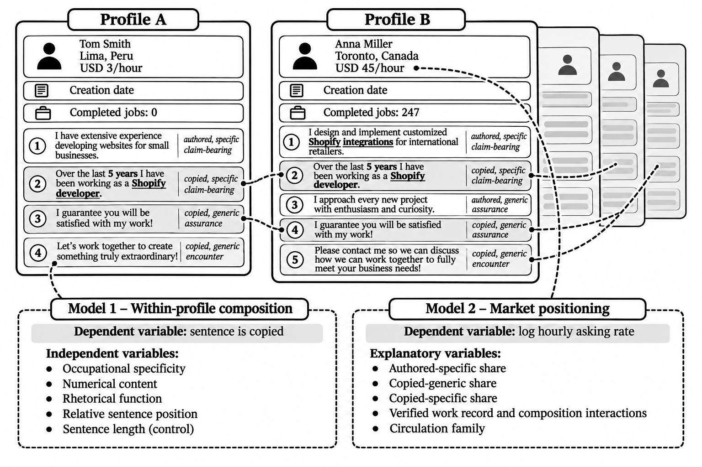

# Introduction

A freelancer's public profile brings together two very different kinds of information.
Completed jobs, recorded hours, and client ratings summarize work carried out through the platform [@HongPavlou2017; @MorenoTerwiesch2014; @Yoganarasimhan2013].
The profile description explains who the worker is, what the worker can do, and why a client should engage them [@BlythJarrahiLutzEtAl2022; @Gandini2016].
The first kind of information is produced through transactions and recorded by the platform, so the worker has little direct control over it.
The second is written by the worker and can be revised at any time.
Both are visible to prospective clients, but the description is also available to other workers.
A sentence about reliability, expertise, or client satisfaction can become part of someone else's profile without transferring the experience it purports to describe.

Signaling theory makes this difference a puzzle.
A signal separates senders only if some find it harder to produce than others; when any sender can produce it at no cost, senders pool and receivers learn to discount it [@Spence1973; @ConnellyCertoIrelandReutzel2011; @BerghConnellyKetchenEtAl2014].
Profile text is such a signal, because any worker can copy another's description.
On this logic, copied text should tell clients nothing, and workers should gain nothing from copying it.
Yet copying happens: freelancers read one another's profiles, clients notice copy-pasted text [@GussekWiesche2024; @BlythJarrahiLutzEtAl2022], and in our data a quarter of profiles share at least one sentence word for word with another worker's.
And profile text still relates to market outcomes, even alongside verified records [@HolthausStock2018; @YueHong2025].
Work on rhetorical signals shows that inexpensive text can matter when it accompanies costly signals whose credibility clients attribute to the whole signal portfolio [@SteigenbergerWilhelm2018; @PlummerAllisonConnelly2016], but it treats each text as its sender's own.
Signaling theory lacks an account of how text that circulates among senders can still distinguish them.

We call the conjunction of public visibility and inexpensive textual reproduction *copyability*.
Copyability is a property of the platform's information environment, not an allegation about the intentions of a particular worker.
It makes others' self-presentation available as a resource, so that copying becomes one of the practices through which a profile is composed.
Our research question is:
*How do workers compose their profiles under copyability, and how can the resulting composition still distinguish them in the online labor market?*

We investigate this question through computationally intensive theory construction [@BerenteSeidelSafadi2019; @MirandaBerenteSeidelEtAl2022].
Using public Upwork profile records, we construct a corpus of  qualifying sentences from  workers.
Sequence-preserving text-reuse detection identifies shared wording rather than merely common topics.
We then organize the analysis around two models.
*Model 1* examines composition within profiles: which sentences are shared and which have no detected exact match?
*Model 2* examines whether composition distinguishes workers in the market: how are a profile's composition and its membership in circulation families, groups of shared passages that tend to be adopted together, associated with its posted asking rate, our measure of market position, including where verified records are available?
Descriptive analyses of how shared wording spreads across workers, and of where near-identical sentences differ, help interpret both models.
A supplementary qualitative analysis of theoretically sampled profiles illustrates what the estimated patterns look like in actual descriptions.

The findings do not support a collapse of textual self-presentation into interchangeable cheap talk.
Exact sharing occurs in  of profiles, yet most of these workers share only part of their description, typically  sentences, and write the rest themselves.
What they share is selective: occupation-specific and numerical claims are less likely to be shared, whereas assurances, invitations to get in touch, and sentences late in the profile are more likely to be.
Across workers, authored-specific composition is associated with higher asking rates and shared-generic composition with lower asking rates, and circulation families add information beyond geographic proximity and worker covariates.
Most importantly, the shared-generic association does not disappear among workers with substantial completed-job records.

We develop these patterns into a process model.
Copyability is its central condition, profile composition is its practice, and market position is its outcome.
Profile composition is the combination of two concurrent practices, authoring and copying.
Three propositions state the mechanisms that link the constructs: selective composition, composition and circulation associations with market position, and non-substitution between records and text.
The account distinguishes three dimensions of textual signals: *content*, or what a claim says; *profile composition*, or how authored and copied wording combine in a profile; and *circulation*, or how copied wording is distributed across workers.
The distinction does not imply that we can recover a sentence's original author or externally verified source.
It explains why reproducible content can coexist with informative composition and circulation.

This account makes three contributions.
First, it establishes copying as a practice of profile composition.
That copyability makes copying possible is close to self-evident, but its consequences have not been examined as part of how self-presentation is composed under signaling.
We show that workers neither compose afresh nor copy wholesale: they combine authoring and copying selectively.
Copyability thereby organizes self-presentation instead of only threatening the credibility of a signal.
Second, we derive more detailed propositions from the findings about how composition is associated with market position.
Authored-specific and shared-generic composition are associated with opposite positions, and circulation families carry information beyond broad geography, occupation, and recorded work.
Textual self-presentation is therefore both individually composed and relationally structured.
Third, we establish non-substitution as a boundary to a reputation-centered account.
Verified records do not make the measured textual associations disappear.
The resulting theory is not that clients reward originality or punish copying.
It is that the informational structure of a copyable profile cannot be reduced either to its words in isolation or to the verified record beside them.

# Conceptual Background

## Signals, Records, and Credentials in Online Labor Markets

Online labor markets connect geographically dispersed workers and clients through digitally represented information [@Horton2010; @LehdonvirtaEtAl2019].
For services that are difficult to evaluate before delivery, clients confront uncertainty about competence, reliability, and fit, and about whether a worker is available at all [@Horton2019].
Because applications are cheap, workers apply widely and many openings never lead to a contract [@KokkodisIpeirotis2023], so clients screen quickly on whatever is visible.
Research on online labor markets accordingly examines reputation, standardized information, and provider characteristics in hiring and market outcomes [@HongPavlou2017; @MorenoTerwiesch2014; @AgrawalLaceteraLyons2016].

Signaling theory explains how observable features can help distinguish senders with otherwise hidden attributes [@Spence1973; @ConnellyCertoIrelandReutzel2011].
Work on online labor markets separates assessment signals, whose production requires possessing the quality signaled, from conventional signals, whose link to quality rests on social convention and which any sender can produce [@HolthausStock2018].
The classical expectation is that cost makes signals credible, and platform evidence is consistent with it.
When a platform removed the fee for a certification test, the certification's hiring and price advantage narrowed and workers certified under the new policy were less likely to deliver high-quality work [@BaiGaoGoesEtAl2026].
Employers avoided workers who offered a guarantee deposit that high- and low-quality workers could produce equally well [@GaoLinLiuEtAl2026].
Yet costless communication is not necessarily uninformative [@FarrellGibbons1989].
A free capacity status became informative on one platform because workers' later behavior matched what they had declared [@Horton2019], and rhetorical signals can organize interpretation of a sender without certifying a costly investment [@SteigenbergerWilhelm2018].

By *verified records* we mean what the platform itself records from transactions: completed jobs, recorded hours, and client ratings.
They have a particularly direct relationship to activity on the platform.
A worker cannot acquire a substantial completed-job history without doing the work.
Recorded histories can reduce uncertainty.
Achievement records predict supplier quality, whereas skill credentials do so only under some conditions [@KathuriaEtAl2021].
They are nonetheless neither complete nor free of strategic behavior and evaluation problems [@Tadelis2016; @Rahman2021].
Ratings are inflated and blend heterogeneous skills into one score [@KokkodisIpeirotis2016; @Kokkodis2021], and clients and contractors shape them through relational practices even under double-blind feedback [@Rahman2018].
Their absence is also a practical obstacle: workers without an established record can struggle to obtain the very work through which such a record is built [@Pallais2014; @StantonThomas2016; @LiangHongGu2025].

Whether records substitute for other signals is an open question.
Group-level cues such as country image matter when a provider has no individual record, and their role fades as individual reputation accumulates [@KanatHongRaghu2018].
A monitoring tool that verified ongoing work reduced employers' preference for experienced workers [@LiangHongGu2025].
The weight placed on any one signal thus appears to depend on what else is verified.
*Substitution* would mean that text becomes less informative about market position as records accumulate; *non-substitution*, that textual differences persist among workers with similar records.
Records, however, are only part of a profile.
The rest is text that workers write themselves.

## Profile Text as a Signal

Descriptions differ from records because workers can select, order, and frame their claims.
Self-presentation is not simply the disclosure of attributes; it also organizes how an audience encounters them [@Goffman1959].
Freelancers describe services, translate experience into promises of usefulness, and present working styles alongside credentials, while clients read both what workers say about themselves and what the writing reveals about them [@BlythJarrahiLutzEtAl2022].
Potential clients assess freelancers largely through the profile [@GussekWiesche2023].
Self-presentation is especially important where professional recognition is no longer supplied by a stable organizational affiliation [@BarleyKunda2006; @AshfordCazaReid2018; @PetriglieriAshfordWrzesniewski2019].

A growing body of work finds that the content and style of this text relate to market outcomes beyond what records capture.
Coded self-promotion is associated with higher one-year earnings and ingratiation with lower earnings, while a verified rating is not associated with earnings in the same model [@HolthausStock2018].
Similarity between a profile and a job opening is positively associated with being hired, whereas the feedback score alone ranks applicants barely better than chance [@KokkodisPapadimitriouIpeirotis2015].
Applications that are longer, closer to the job description, and less prototypical of their category are hired more often [@TroncosoLuo2023].
A more analytical writing style in a profile is associated with lower subsequent earnings, and the association is conditioned by ratings, badges, education, and platform hours [@YueHong2025].

What counts as specific is a matter of fit rather than of quality.
Skills in online labor markets cluster into categories, and diverse skill sets are associated with higher wages than narrow ones [@Anderson2017].
Gig work unbundles occupations into individual skills, so specificity is expressed through what a worker is hired for rather than through a job title [@VanSlagerenHerrmann2024].
Specialized services give freelancers more autonomy over their rates, whereas generalized services face price competition [@PulignanoMuszynskiTapia2024].
Yet more cohesive skill sets are hired more often but earn lower hourly wages [@Kokkodis2023], incongruent skills help in low-skill and hurt in high-skill categories [@FuEtAl2021], and a formal writing style is penalized outside technical occupations [@YueHong2025].
Specificity is therefore not rewarded uniformly; its value depends on occupation, outcome, and audience.

These studies treat text as the property of a single worker.
Each measures what one profile says, how it reads, or how it relates to a job, and none asks whether the same wording appears in other workers' profiles.
That omission is harmless as long as text can be assumed to be composed afresh.
It matters once anyone can copy what others have written.

## Copyable Text: A Puzzle for Signaling

Classical signaling logic makes copyable profile text a puzzle.
A signal separates senders only if some find it harder to produce than others; if a signal is easy to copy, all senders will use it, which destroys its informational value [@BerghConnellyKetchenEtAl2014].
On platforms, cheap and widely available signals have indeed been diluted or discounted [@BaiGaoGoesEtAl2026; @GaoLinLiuEtAl2026].
Studies of text in these markets sometimes assume instead that detailed writing is costly to produce and therefore credible [@AlshalfanMahdikhani2026], without testing whether it is copied.

Profile text is easy to copy.
Digital artifacts such as profile descriptions are editable and reproducible, and their informational properties are shaped by the systems through which they are represented and accessed [@KallinikosAaltonenMarton2013].
Profiles are also public, so freelancers can read one another's descriptions and observe one another's career paths [@GussekWiesche2024].
Copying is also visible to clients, who report noticing copy-pasted proposals and stolen portfolio material and read them as laziness [@BlythJarrahiLutzEtAl2022].
Unlike a badge or a deposit, however, a copied sentence carries no label that distinguishes it from composed text.
Reused text is not peculiar to freelancing.
Copied passages appear in residency application essays [@SegalGelfandHurwitzEtAl2010], app stores contain copycat apps that imitate original ones [@WangLiSingh2018], crowdfunding updates repeat clichés [@BaoLeeZhang2025], and IPO prospectuses repeat standard content from earlier prospectuses in the same industry [@HanleyHoberg2010].
In these settings, too, reused text tends to carry standard rather than specific content.

Yet, as the studies reviewed above show, profile text relates to outcomes even alongside verified records.
Work on rhetorical signals explains why inexpensive text can matter: clients attribute the credibility of costly signals to the whole signal portfolio, including the rhetoric that accompanies them [@SteigenbergerWilhelm2018; @PlummerAllisonConnelly2016].
Like the studies of profile text, however, it treats each text as its sender's own.
Signaling theory therefore lacks an account of how text that circulates among senders can still distinguish them, and studies that measure each profile in isolation cannot provide one.

If wording circulates, it need not circulate evenly.
Online work connects distant participants, but place still matters.
Country image shapes provider outcomes when individual records are thin [@KanatHongRaghu2018], and geographic and social distance remain relevant to exchange [@GefenCarmel2008; @HongPavlou2017; @LehdonvirtaEtAl2019].
Workers also learn to navigate platforms informally, often outside formal organizations [@SutherlandJarrahiDunnNelson2020].
Place, occupation, and the period in which a description was created are therefore plausible dimensions along which wording could be shared.

This leaves the question that guides our study: *How do workers compose their profiles under copyability, and how can the resulting composition still distinguish them in the online labor market?*

# Research Method

## Computationally Intensive Theory Construction

We adopted a data-driven approach that iterates between computational patterns and theoretical interpretation [@BerenteSeidelSafadi2019; @MirandaBerenteSeidelEtAl2022; @Lindberg2020].
Interpretations changed over these iterations; for example, counting distinct adoptions instead of matching pairs showed that a few dominant passages did not represent most sharing, which redirected the analysis toward selective composition and structured circulation.
Text-reuse detection makes shared wording observable at a scale at which reading profiles alone cannot establish its distribution.
The technique comes from political science, where it traces how bill text moves between legislators and legislatures [@WilkersonEtAl2015; @LinderEtAl2020; @GavaJaquetSciarini2021].
Unlike topic models and other document-level text-as-data methods [@GrimmerStewart2013], which describe the themes that documents share, it identifies the specific passages that recur across documents.
We use it to show where in a profile reuse occurs and who shares it.
Statistical models then characterize relationships within and across profiles.
Interpretation relates these relationships to the concepts of the Conceptual Background: signaling, copyability, circulation, and substitution.
Consistent with computationally intensive theory construction, the models support theory development rather than a claim of independent confirmatory testing.

The analytic sequence in @fig-method has five phases.
We first construct the sentence corpus from the public profiles.
A separate text-reuse phase then detects cross-worker reuse, validates the similarity scores, and describes reuse for sentences, workers, recurring passages (scripts), and groups of passages adopted together (families); its output is the input to both models.
The main analysis estimates Model 1 and Model 2, together with the content, function, position, and variant-alignment descriptions and the verified-record, city, and circulation-family components that inform their interpretation.
The secondary analysis has two parts: a qualitative reading of theoretically sampled profiles and near-copy pairs, which draws its cases from the patterns the models identify, and robustness checks on alternative measurements, samples, and outcomes.
The final phase develops a theoretical model and propositions from these results.

{#fig-method}

The two models answer different questions at different units of analysis.
A worker-level comparison alone cannot distinguish selective composition inside a profile from differences in who participates in reuse, and a sentence-level comparison alone cannot show how the resulting composition relates to market position.
The two-model design connects these levels without treating them as a single causal sequence.

## Setting and Data Collection

Upwork provides a useful setting because workers present diverse knowledge services through public profiles that combine editable descriptions, asking rates, and platform-recorded work.
The input file contains  worker-profile records.
Data were collected on September 21, 2023, in a single run through public Upwork API endpoints.
A scraper assembled unique worker identifiers from Upwork's public category pages, which are organized by occupational category, subcategory, and occupation.
A profile-detail script then retrieved the public record for each listed identifier.

The collection aimed to retrieve every public profile, but its completeness cannot be verified against the platform's records, so we treat the data as a large cross-section of retrieved profiles rather than a census.
No claim that the collection covers every occupation or all active workers is required for the within-corpus analysis.

Besides the description, each record contains the posted hourly rate, completed jobs, recorded hours, rating, listed occupations, country, city, and agency affiliation.
Two timestamps record when the description was created and last updated; they do not date the account.
We measure *description age* from the description's creation to the latest update observed in the data, September 8, 2023 (Appendix A).

We took several safeguards.
The analysis uses only public profile text and metadata.
Workers are identified by neither platform identifiers nor names, and the paper reproduces no complete description or client name.
We quote only short passages that recur across workers, namely exact-shared sentences and, where we show personalization, near-copy variants.
Because each such passage appears, in identical or near-identical form, in more than one worker's profile, quoting it does not by itself identify any one worker.
We paraphrase unshared, personal, and client material.
Full profiles, identifiers, and case comparisons are internal research materials, not publication supplements.

## Corpus Construction and Reuse Detection

We first remove descriptions that share no common vocabulary with the rest of the corpus, a filter inherited from the original detection pipeline: a description must contain at least one non-stopword token without digits that occurs more than 100 times in the input file.
This retains  profiles.
The filter favors English descriptions but is not a language classifier.
We normalize whitespace, segment descriptions with a sentence tokenizer, and retain units containing 8–50 whitespace-counted words.
The resulting reuse frame contains  sentences in  profiles.
Counts of words for eligibility and tokens for content analysis use different tokenization rules, documented in Appendix B.

Each sentence is lowercased and represented by a set of word five-grams.
For sentence shingle sets $A$ and $B$, similarity is

$$
J(A,B)=\frac{|A\cap B|}{|A\cup B|}.
$$

This measure preserves local word sequence rather than only thematic vocabulary [@Broder1997; @WilkersonEtAl2015].
Comparing every pair of  sentences is impractical, so we first generate candidate pairs and then compute their exact Jaccard scores.
Candidates come from MinHash signatures with 240 permutations [@Broder1997] and locality-sensitive hashing with 60 bands of four rows.
This configuration almost always detects pairs with $J\geq .5$ (see below) while keeping the number of candidates manageable.
Even so, rebuilding the derived data and fitting both models and the robustness checks takes about 1.5 hours on 16 cores (Appendix E).
Candidate generation produces  scored pairs;  same-worker pairs are excluded.

The main definition of *exact sharing* is $J=1$: equality of word-five-gram sets across workers.
It is not character-by-character identity.
Punctuation and case normalization, tokenization, and the use of sets can make surface forms differ while their measured sets are equal.
A *script* is a connected component of exact-sharing sentences held by at least two workers.
A sentence is operationally *authored* when it has no detected exact cross-worker match.
This category includes non-exact near-copies but cannot establish independent composition.

Candidate detection is similarity-dependent.
Under the LSH configuration, the probability of becoming a candidate is $1-(1-J^4)^{60}$: approximately  at $J=.3$ and  at $J=.5$, approaching one at higher similarities.
We consequently center inference on exact sharing, use $J\geq .7$ as a model sensitivity check, and use $.5\leq J<1$ for variant alignment.
Low-similarity candidates are not an exhaustive census of weaker reuse.
Nor do unobserved matches outside this corpus establish originality.



## Constructs and Measurements

Three dimensions of a textual signal frame the patterns surfaced by the analysis and organize the measurements and models below.
*Content* is what a sentence claims: its occupational detail, numerical claims, and rhetorical function.
*Profile composition* is how two practices, authoring and copying, combine across that content within a profile.
We observe authoring as sentences with no detected exact cross-worker match (authored) and copying as sentences with an exact cross-worker match (exact-shared).
*Circulation* is how copied wording is distributed across workers.
The dimensions can carry different information.
The same assurance can appear in many profiles, but its prevalence within a particular composition and its co-occurrence with other passages can identify a more particular presentation pattern.
Two constructs lie outside the text.
We operationalize *market position* as the posted asking rate and examine ratings and recorded hours as alternative outcomes in the robustness checks.
*Verified records* enter Model 2 as completed-job groups, whose interactions with composition test whether records substitute for text.
Copyability is a condition of the setting and is not measured.
@tbl-measures summarizes the dimensions, their constructs and measures, and the role each plays in the two models; control variables are listed with Model 2 below.

| Dimension | Construct | Role | Operationalization | Interpretation and boundary |
|:---|:---|:---|:---|:---|
| Content | Occupational specificity | Model 1 predictor; content split in Model 2 | Distinct informative word types; informative if used by at least 100 workers and occupational KL divergence is at least .5 bits | Occupational concentration, not uniquely personal truth |
| Content | Numerical content | Model 1 predictor | At least one numeric token under the content tokenizer | Can concern history, quantities, or service promises |
| Content | Rhetorical function | Model 1 predictor | Dictionary moves collapsed to claim-bearing, assurance, encounter formula, or other | Claim-bearing combines identity, credential, capability; estimation label: “individuating claim” |
| Profile composition | Authoring and copying (authored and exact-shared sentences) | Model 1 outcome; basis of the Model 2 shares | Exact-shared: cross-worker word-five-gram match at $J=1$ [@WilkersonEtAl2015; @LinderEtAl2020]. Authored: no detected exact match | Shared measured form, not verified copying intent or direction; authored includes non-exact near-copies |
| Profile composition | Sentence position | Model 1 predictor | Relative position among qualifying sentences: 0 for the first, 1 for the last | Index among qualifying units; does not necessarily equal literal position in the description text |
| Profile composition | Composition shares | Model 2 predictor | Authored-specific, shared-generic, shared-specific sentence shares; authored-generic omitted | Shares sum to one across the four categories |
| Circulation | Circulation family | Model 2 predictor (form 2c) | Co-adoption components of scripts; dominant family for each sharer | Circulation-based proxy, not an externally verified origin |
| Outside the text | Verified record | Model 2 moderator | Completed-job groups: 0, 1–9, 10–49, 50+ [cf. @Pallais2014; @KanatHongRaghu2018; @KathuriaEtAl2021] | Platform-recorded work, distinct from textual claims about experience |
| Outside the text | Market position | Model 2 outcome | Posted asking rate: log posted hourly rate, USD 3–500 [cf. @MorenoTerwiesch2014; @Kokkodis2023] | Asking price, not realized wage or observed client valuation |
| Condition | Copyability | Condition of the setting | Not measured: public visibility of profiles combined with inexpensive textual reproduction | Property of the platform's information environment, not of individual workers |

: Dimensions, constructs, and measurements {#tbl-measures}

**Content.**
We estimate a specificity lexicon on sentences with no detected sharing at $J\geq .5$, counting each worker once per word type.
For a word's users, we compare the distribution of first-listed occupations with the corresponding worker baseline using Kullback–Leibler divergence.
Types used by at least 100 workers and carrying at least .5 bits of divergence, excluding numeric types, are informative.
The lexicon contains  informative types.
A sentence is specific if it contains at least one informative type; the same indicator enters Model 1 and divides the Model 2 composition shares.
Estimating the lexicon on less-shared text reduces the possibility that a circulating template manufactures its own occupational specificity, but does not independently validate the construct.
A sentence has numerical content if it contains at least one numeric token (Appendix B).
We use occupational wording and numerical content as indicators of how narrowly a claim applies, not as measures of whether a sentence is true for one worker alone.
For rhetorical function, a transparent, ordered dictionary assigns moves before they are collapsed for Model 1.
Identity, credential, and capability moves form the reference group; character and process moves are assurances; encounter moves include invitations and courtesies.
Agency and unmatched moves fall in “other” in the model.
We use “claim-bearing” as readable shorthand for the reference grouping, not as a change to the estimation labels.
The ordered rules can privilege an assurance keyword over an occupational or testimonial function in a mixed sentence.
We retain this dictionary measurement and document supplementary disagreement diagnostics between the dictionary and the sentence codes from the qualitative analysis, without treating either as a benchmark.

**Profile composition.**
At the sentence level, profile composition is a sentence's exact-shared or authored status together with its relative position, which runs from 0 for a profile's first qualifying sentence to 1 for its last.
At the worker level, the four composition shares cross exact-shared or authored status with specific or generic content, so that authored-specific, authored-generic, shared-specific, and shared-generic shares sum to one.

**Circulation.**
To identify passages that recur together, scripts with at least five adopters are linked when at least three workers hold both and the overlap coefficient—co-adopters divided by the smaller script's adopter count—is at least .5.
Connected components form multi-script circulation families; unlinked scripts retain their own family identifiers.
A worker's dominant family covers the largest number of that worker's shared sentence instances, with ties favoring the family represented by a larger script.
This assignment summarizes circulation but does not represent all memberships of workers who combine several families.
Locality, cohort proximity, and price-peer comparisons describe the relational structure of reuse separately from the asking-rate model.

## Model 1: Within-Profile Composition

Model 1 estimates which qualifying sentences are shared within the same description.
For sentence $i$ in worker profile $j$, the main specification is

$$
\operatorname{logit}[Pr(S_{ij}=1)]=\alpha_j+
\beta_1K_{ij}+\beta_2N_{ij}+
\boldsymbol\beta_3'\mathbf F_{ij}+\beta_4R_{ij}+\beta_5\log (L_{ij}),
$$

where $S$ denotes exact sharing, $K$ indicates at least one occupation-informative type, $N$ indicates a numeric token, $\mathbf F$ represents rhetorical function, $R$ is relative position in the profile (0 for the first qualifying sentence, 1 for the last), and $L$ is word count.
Worker fixed effects $\alpha_j$ absorb worker-level differences shared by all sentences in a profile.
The model therefore addresses composition, not the between-worker question of who shares text.
Length controls distinguish content and position from the mechanical difficulty of reproducing a longer sequence.

We estimate a binomial fixed-effects logit with worker-clustered standard errors.
Profiles with at least two qualifying sentences contribute  eligible units; identification in the logit comes from  sentences in  mixed profiles containing both shared and non-exact-shared units.
Entirely shared and entirely unshared profiles do not identify its slopes.
A worker-fixed-effects linear-probability specification examines whether the principal composition pattern depends on the logit link.
Its eligible sample includes invariant-outcome profiles and is therefore larger than the logit's identifying sample.

## Model 2: Composition, Circulation Families, and Asking Rates

Model 2 uses  workers with eligible asking rates and observed description age.
For each worker, the four composition shares distinguish authored/shared wording and specific/generic content.
We omit authored-generic share and estimate three forms of the same worker-level model: composition without record interactions (2a), composition with record interactions (2b), and a multilevel form adding city and circulation-family effects (2c).
The general form is

$$
\begin{aligned}
\log (r_j)={}&\theta_1 A^S_j+\theta_2 C^G_j+\theta_3 C^S_j
 +\sum_{k=1}^{3}\left(\delta_k A^S_j+\eta_k C_j\right)D_{jk}\\
&+\mathbf x_j'\boldsymbol\gamma+\mu_{c(j)}+\lambda_{o(j)}
 +u_{\operatorname{city}(j)}+Q_jv_{\operatorname{family}(j)}+\varepsilon_j.
\end{aligned}
$$

Here $A^S$ is authored-specific share, $C^G$ shared-generic share, $C^S$ shared-specific share, $C=C^G+C^S$ total shared share, $D_k$ the three nonzero-job indicators, and $Q$ an indicator that the worker has any exact sharing.
The common $\eta_k$ interaction shifts the shared-generic and shared-specific slopes equally within a record group.
It is a specification restriction, not an estimate of separate record interactions for each shared type.
Form 2a excludes the interaction terms; forms 2a and 2b exclude random effects.

Controls include completed-job groups, rating bands, description age, agency affiliation, number of listed occupations, and log description characters.
Country and first-listed-occupation effects account for broad market differences.
Countries with fewer than 200 workers in the qualifying frame, together with missing country, are pooled as “Other.”
Missing occupation has its own category; city groups are nested in country, with country-specific missing-city groups.

Forms 2a and 2b use absorbed country and occupation effects and country-clustered standard errors.
Form 2c is fitted by maximum likelihood and adds a family random effect that applies only to sharers.
Because exact sharing concentrates within cities and countries, 2c also adds a city random intercept, nested in country, so that families are estimated net of geographic proximity at both levels.
It contains  exact sharers,  represented families, and  city groups.
Its fixed-part standard errors are model-based, not country-clustered.
We report the family variance relative to family-plus-residual variance, $\sigma_v^2/(\sigma_v^2+\sigma_\varepsilon^2)$, and compare fits with and without the family component.
This ratio excludes city variance and is not the share of total asking-rate variation explained by circulation families.

Composition coefficients describe a unit change in a share relative to the omitted category.
Reporting $100[\exp(\theta)-1]$ therefore gives a hypothetical contrast between an entirely one-type profile and an entirely authored-generic profile.
It is not the effect of copying one sentence or the change expected for a typical worker.
The models describe conditional asking-rate associations.
They do not observe client recognition of copying, client valuation of prose, or causal consequences of adopting a template.

## Supplementary Qualitative Analysis

We selected 150 full profiles from ten theoretically defined sampling groups to inspect typical composition, shared-specific openings, heavily shared descriptions, experienced sharers, different computational assembly patterns, family-price contrasts, and authored-premium contrasts.
The material contains 1,401 qualifying sentences, 100 profile-nearest non-exact variants, and 100 separately sampled near-copy pairs.
The latter are divided equally between same and different first-listed occupations.
Appendix C details the sampling and procedure.

The lead author coded the sampled material using a codebook with ordered decision rules and discussed the results with the other authors.
Coding proceeded in three passes (Appendix C).
In the first, sentence moves, portability judgments, and profile-level language and positioning codes were assigned while computed sharing flags, sampling cell, asking rate, experience, rating, and country were hidden.
In the second, with reuse information shown, near-copy variants, profile assembly, the location of claims about identity, credentials, and capabilities, and coherence were coded.
In the third, the 100 separately sampled near-copy pairs were coded for edit type and fit.

# Findings

The findings first describe how much reuse there is and how it circulates across workers, then report Model 1 and Model 2, and close with robustness checks.
Quoted excerpts come from the supplementary qualitative analysis and illustrate the estimates.
The profiles were selected in response to the computational results, some on price, so they show what the categories look like rather than adding evidence for the associations; Appendix C4 collects further examples.

## A Substantial, Partially Used Repertoire

Exact sharing involves  workers, or  of the -worker reuse frame.
There are  scripts.
This is substantial circulation without a universally adopted platform text: the largest script has  distinct adopters.
For example, the second most widely shared sentence is a full pitch, not a stock phrase, and appears in the descriptions of  workers:

> Whether you're trying to win work, list your services or even create a whole online store — I can help!

Most scripts are far smaller, though:  are dyadic.
Reuse contains a long tail of small-scale sharing as well as more visible recurring passages.

Counting pairs of matching sentences would exaggerate how concentrated sharing is.
A sentence held by 500 workers creates more than 100,000 matching pairs, so the 100 most-adopted scripts account for  of exact sentence pairs.
Counted by worker instead, they make up only  of all cases in which a worker holds a script.
Most sharing therefore involves the long tail of small scripts, not a few widely known templates.

Most sharers share only part of their description.
Among exact sharers, the median is  shared qualifying sentences,  of qualifying sentences, and  of qualifying words.
Shared material also tends to appear later.
For profiles with at least three qualifying units, exact-sharing rates are  at the first position,  in middle positions, and  at the last.
In  of mixed profiles, shared sentences occur later on average than non-exact-shared sentences.
@fig-sharing shows the spread.
These descriptive gradients motivate a within-profile model; they do not yet distinguish position from content or length.

{#fig-sharing}

## Circulation Is Relationally Structured

@fig-circulation compares similarity bands using worker pairs, rather than counting every sentence match as a separate worker relationship.
Relative to random mixing of the same pair endpoints, exact-sharing lifts are  for city,  for country, and  for first-listed occupation.
The city gradient is especially pronounced as similarity increases.
Because the comparison holds each pair's workers fixed, these lifts do not simply reflect that some countries contribute many profiles.
Sharing also clusters, more weakly, by occupation.

{#fig-circulation}

Structure remains even among pairs sharing only lexicon-generic sentences: country lift is  and occupation lift .
Generic content does not imply socially unrestricted circulation.
Among same-city exact-sharing pairs, description-creation dates are within 30 days of one another  times as often as in the matched random comparison, and within seven days  times as often.
These dates concern description creation, not necessarily entry onto the platform.
Exact-sharing partners' log asking rates correlate , compared with  when the partner is replaced by a randomly selected worker from the same country–occupation stratum.

Together, these findings support treating shared wording as a relationally organized resource.
They are compatible with local learning environments, common organizational materials, or shared exposure to examples.
They do not identify a tutorial, onboarding process, agency, or person as the origin.
This distinction matters for Model 2: circulation families can be informative about asking-rate differences even when their external sources and transmission channels remain unknown.

## Model 1: Selective Profile Composition

Model 1 analyses sentences within the same description.
Each qualifying sentence is a unit, and the outcome is whether it is exact-shared.
The predictors are the sentence's occupational specificity, whether it contains a numeric token, its rhetorical function, its relative position in the profile, and its length.
Worker fixed effects mean that each sentence is compared only with other sentences in the same profile, so the estimates describe composition and not differences between workers.

@tbl-model1 reports the within-profile estimates for all predictors.
Occupation-specific and numerical sentences are much less likely to be exact-shared than other sentences in the same profile: a sentence with at least one occupation-informative word has an odds ratio of , and a numeric token an odds ratio of .
Assurances () and encounter formulae () have higher sharing odds than the reference group of identity, credential, and capability claims, and a profile's last qualifying sentence has  times the sharing odds of its first.
Longer sentences are less likely to be exact-shared, as expected for an exact match.
The excerpts below show what selective composition and adaptation look like within descriptions.



An architecture profile shows selective composition within one description.
Its opening sentences, which describe the architect's design specialisms, clientele, and software, have no exact match elsewhere.
A shared lead-in held by  workers then introduces attributed client quotations, and the profile closes with two further shared sentences, held by  and  workers, the last of which is

> Let's work together to create something truly extraordinary!

The claims that must fit this architect are authored; the lead-in and the close would fit almost any worker.
These are tendencies, not rules: some specific sentences are shared, and some authored evidence appears late in a profile (Appendix C4).

Variant alignments show how copied wording is adapted.
In  sampled pairs with $.5\leq J<1$, numerical and occupation-informative tokens are substituted or deleted at rates of  and , against  for other content words and  for function words (Appendix B6).
In one recurring sentence, the worker's own service is inserted into otherwise identical wording:

> We always prefer to keep our work transparent … \
> We always prefer to keep our *web development & application development* work transparent … \
> We always prefer to keep our *CRM development & consultation* work transparent …

## Model 2: Composition and Circulation-Family Differences

Model 2 analyses workers.
The outcome is the log posted asking rate, and the main predictors are the shares of a worker's qualifying sentences that are authored-specific, shared-generic, and shared-specific, with authored-generic as the omitted reference.
Controls include completed-job groups, ratings, hours, and description characteristics, plus country and occupation effects.
It is estimated in three forms: composition alone (2a), composition interacted with completed-job groups (2b), and a multilevel form that adds city and circulation-family random intercepts (2c).

### Composition Is Associated with Market Position

@tbl-model2 presents the three forms of Model 2 as log-rate coefficients $\theta$; in the text we convert them to percentage differences, $100[\exp(\theta)-1]$.
Without record interactions, a full-unit authored-specific contrast is associated with  in asking rate relative to authored-generic composition.
The shared-generic contrast is , and the shared-specific contrast .
Each coefficient conditions on recorded work, description characteristics, agency affiliation, and country and occupation effects.
These contrasts summarize the scale of the fitted composition slopes; most sharers do not have descriptions consisting entirely of shared sentences.



The key distinction is not simply between specific and generic words.
Authored-specific composition is positively associated with asking rate, whereas shared-generic composition is negatively associated with it.
The latter remains the strongest and most stable textual discount.
Shared-specific composition also has a negative coefficient in the main specification, but its sign changes under a stricter specificity rule.
A universal discount for shared expertise is therefore not warranted.

Two sampled designers illustrate the authored-specific side.
Both draw on the same circulation family and share an originality pledge held by  workers, and their openings recur in adapted form with different experience claims:

> I am a full time freelance graphic designer with over *15 years* of professional experience … \
> Hi, I am full time freelance graphic designer and illustrator with over *3 years* of professional experience …

The first designer, with  completed jobs, posts USD  per hour; the second, with  completed jobs, posts USD .
The shared-generic side is visible in a web design profile at USD  per hour, most of whose qualifying sentences are shared, including an assurance held by  workers:

> I guarantee you will be satisfied with my work!

### Circulation Families Add Information Beyond Geographic Proximity

Because exact sharing concentrates within cities and countries, a family component could simply reflect where its members are located.
Form 2c therefore estimates families net of geographic proximity: country fixed effects absorb differences between countries, and a city random intercept, nested in country, absorbs differences between cities.
The multilevel form attributes variance  to circulation families,  to city, and  to the residual.
The family-to-family-plus-residual ratio is .
Adding the family component yields a likelihood-ratio statistic of approximately  against the otherwise comparable model with country and city effects only.
The component is consequently not reducible to the modeled geographic structure.
Its interpretation remains conditional on the specified controls, dominant-family assignment, and random-effects assumptions.

The composition relationships also remain in the multilevel form.
For the zero-job reference group, full-unit contrasts are approximately  for authored-specific,  for shared-generic, and  for shared-specific composition.
These should be compared with the zero-job coefficients of the interaction fixed-effects form, not directly with the average slopes of form 2a.
The attenuation of the shared-generic coefficient after adding families is compatible with part of its association being linked to circulation, but is not a causal decomposition.

A low-priced family in the sample shows what this means.
Its three sampled members work in the Philippines and Pakistan, are listed under Customer Service and IT & Networking, and have between  and  completed jobs.
All three post between USD  and  per hour.
Two of them share a block of availability and reliability sentences, including one held by  workers:

> I am available around the clock and willing meet the deadlines.

Such blocks could circulate through common examples, agencies, or learning resources.

### Verified Records Do Not Eliminate the Shared-Generic Association

The interaction form addresses whether textual associations become negligible when platform records are available.
@fig-records shows full-unit contrasts within completed-job groups.
Shared-generic composition is associated with , , , and  in asking rate in the zero, 1–9, 10–49, and 50+ groups, respectively.
The association does not shrink as records accumulate; if anything, it is larger among workers with ten or more completed jobs than among those with none.

{#fig-records}

The authored-specific contrasts are less precisely estimated in some completed-job groups, so the result for verified records rests on the shared-generic association.

Two profiles with substantial completed-job records show shared generic wording alongside substantial records.
A Microsoft-platform consultant with  completed jobs and a posted rate of USD  per hour describes certifications and a long specialist history in authored sentences, and closes with an encounter formula held by  workers:

> Please contact me so we can discuss how we can work together to fully meet your business needs!

A full-stack developer with  completed jobs posts USD  per hour and pairs authored claims about a track record with closing formulae held by  and  workers.
In both profiles the shared wording is widespread rather than particular to the experienced worker.

## Robustness and Outcome Triangulation

@tbl-robustness reports the baseline and ten robustness checks: seven changed rate specifications, the Model 1 linear-probability check, and two alternative worker outcomes.
The changed specifications broaden sharing to $J\geq .7$, retain sentences of at least 15 words, exclude agency members, tighten specificity, restrict description-edit timing, restrict geography, or exclude descriptions with at least 90% shared qualifying sentences.
Three checks also refit the family component.
Appendix D reports sample sizes and coefficient-level detail.



The principal composition pattern is retained across the applicable checks.
Authored-specific composition remains positively associated with asking rate, shared-generic composition remains negatively associated, and the shared-generic contrast remains negative in the highest completed-job group.
These results do not depend solely on brief formulae, agency membership, or the most heavily shared descriptions.
Family-to-family-plus-residual variance remains approximately  with the broader sharing threshold and  after excluding agency members.

Two results change.
First, when specificity is defined more strictly, shared-specific composition is associated with a premium of approximately  rather than a discount.
The contrast between authored-specific and shared-generic composition is robust, but there is no general discount for shared occupation-specific wording.
Second, among the  workers whose description was last updated within one day of its creation, circulation families account for less variance (a family ratio of approximately ), although adding them still improves the fit (a likelihood-ratio statistic of approximately ).
In this subset too, the shared-generic contrast remains negative, including  in the 50+ job group.

The alternative outcomes give a different perspective on market position.
Among rated workers with at least five completed jobs, shared-generic composition is positively associated with ratings below 4.8 (OR approximately ); authored-specific composition has no discernible association with this outcome.
In the hours model, conditional on asking rate and the remaining controls, a full-unit shared-generic contrast corresponds to approximately  more in $1+\text{recorded hours}$.

# Theory Development

The two models jointly establish three empirical regularities: within-profile composition is selective; textual composition and circulation families are associated with market position; and the shared-generic association does not disappear where verified records are available.
@fig-theory organizes these regularities and their interpretation as a process model.
Copyability, defined above, is its condition: it makes others' wording available as a resource, and we do not measure it.
Profile composition, the combination of authoring and copying within a description, is the practice through which workers respond to it.
Market position, operationalized as the posted asking rate, is the outcome.
The propositions are drawn as the arrows between constructs because each states the mechanism that links them.
Verified records are not a condition of the setting: many workers have none, and for them the description is much of what a client can read.
We therefore show them as a second practice, reputation building, alongside profile composition.
Together, the two practices build the worker's *signal portfolio*, the set of signals a client reads together [@SteigenbergerWilhelm2018; @MohammedDissanayakeParkEtAl2026]; we call this joint practice signal portfolio building.
Unlike wording, a record cannot be copied.
Proposition 3 asks whether the textual associations persist across record groups.
Circulation families describe how copied wording is distributed across profiles, so the model shows them as a property of copying.

![A process model of profile composition under copyability. Boxes are constructs; the arrows are the propositions, which state the mechanisms linking them. Copyability is the condition, authoring and copying are concurrent practices whose combination is the profile composition, and circulation families are a property of copying that spans profiles. Reputation building, observed as verified records, is a second practice that cannot be copied; together with profile composition it forms signal portfolio building. P3 states that the P2 associations persist across record groups. The diagram summarizes proposed relationships, not an identified causal path model or a temporal sequence.](analysis/output/paper/figures/theory.png){#fig-theory}

The model specifies a condition, practices, and an outcome rather than an ordered sequence of events: authoring and copying are concurrent practices that vary in degree within one profile.
The three dimensions of a textual signal map onto it: content is what the practices act on, profile composition is the practice, and circulation is a property of copying.
The proposed mechanisms concern claim fit, adaptation, and circulation environments.

## Selective Composition of Profiles

Under copyability a worker can author wording, copy it, or combine both.
*Profile composition* is the combination of the two practices, observed as authored and exact-shared sentences (see Constructs and Measurements).

Copyability makes broadly applicable language available without requiring a worker to compose its wording anew.
It does not make all claims equally fitting.
A general communication promise is portable: it can apply to almost any worker.
A statement about a narrow capability applies to fewer workers, and an account of a particular history must fit the worker who makes it.
Copying makes all three equally easy to reproduce, but not equally appropriate to adopt.
The within-profile estimates show that occupational detail and numerical content are associated with less exact sharing even when general worker differences are absorbed.
Assurances and encounter formulae are associated with more sharing; sharing becomes more likely later in the profile.
Alignment results also locate variation disproportionately in occupation-informative and numerical tokens.

These patterns suggest a composition mechanism.
Workers can economize on the reusable portions of presentation while devoting more individual formulation or adaptation to claims that narrow their services and histories.
The relevant unit is not an original profile opposed to a copied one.
It is a profile in which different kinds of claims have different relationships to the circulating repertoire.
Composition can therefore still distinguish workers even when some of its content is common.

A cost-based signaling interpretation is consequently possible without treating the copied words themselves as a costly investment.
Composing a fitting account of capabilities and experience may require knowledge, effort, and the ability to substantiate claims.
The potential cost lies in developing and fitting a presentation to the sender, rather than in acquiring exclusive access to a sentence.
This is an interpretation to be developed from the composition pattern, not something text similarity directly observes.

**Proposition 1—Selective profile composition.**
*Under copyability, workers compose profiles selectively: they copy portable claims and author claims that must fit them, and when they copy wording, they adapt the elements that make it fit.*

The proposition also addresses why composition is mixed.
Copyability explains why workers can copy, but a claim that applies narrowly must still be written to fit.
In the data, most profiles contain no detected exact sharing, and among those that do, reuse is usually partial.
Selective composition is then the plausible response: copy what is portable, and author what must fit.
The adaptation part rests on the near-copy evidence: where wording recurs with variation, the variation falls disproportionately on occupation-informative and numerical words, the elements that make copied wording fit a particular worker.
The proposition describes a tendency, not a prohibition.
It is consistent with detailed shared capabilities and person-specific claims that occur late.
Occupational specificity narrows applicability without necessarily identifying one person, and a copied history claim can be applicable to more than one worker.
The theoretical point is differential composition, not the impossibility of reproducing specific language.
Nor is specificity rewarded uniformly elsewhere in the literature.
More cohesive skill sets raise hiring but lower hourly wages [@Kokkodis2023], and incongruent skills help in low-skill and hurt in high-skill categories [@FuEtAl2021].
We therefore read composition as differentiated fit, not as a quality ranking.

## Composition and Circulation as Informational Dimensions

In @fig-theory, P2a and P2b link profile composition to market position, and P2c links circulation families, a property of copying that spans profiles because it is the co-adoption structure of the wording that copying draws on, to the same outcome.
Model 2 indicates that content and operational authorship should not be collapsed.
Occupationally specific composition has different asking-rate associations depending on whether its wording is shared, while the shared-generic category carries the most stable discount.
A single measure of textual specificity would conflate these combinations; a single reuse indicator would conflate a profile with a small shared close and one dominated by shared assurances.

Earlier work associates conventional signals that any sender can produce with weaker outcomes, for example ingratiation with lower earnings [@HolthausStock2018].
This is consistent with, though it does not explain, the discount we find for shared generic wording.

The family component adds a relational dimension.
The geographic, occupational, and cohort patterns show that generic forms can circulate through bounded environments even though their meanings are broadly applicable.
A worker's shared wording consequently locates the profile in a repertoire that is not randomly distributed across workers.
Family-linked asking-rate differences remain after accounting for geographic proximity, measured at the country and city levels, and measured worker characteristics.
Shared content need not distinguish individual competence to be informative about a presentation environment and its associated market position.

**Proposition 2—Composition and circulation associations.**
*Under copyability, profile composition is associated with market position: (a) authored-specific composition with a premium, (b) shared-generic composition with a discount, and (c) circulation families carry further information about market position.*

The premium and discount are relative to authored-generic composition.
Part (c) means that workers who draw on the same circulation family have more similar market positions than their composition, verified records, and location would predict.
The circulation part rests on co-adoption, not on identified sources.
Families may arise in several ways: workers may imitate salient examples under uncertainty [@DiMaggioPowell1983; @HaunschildMiner1997], draw on recurrent genres of self-presentation [@YatesOrlikowski1992; @OrlikowskiYates1994], learn from peers [@SutherlandJarrahiDunnNelson2020; @GussekWiesche2024], or share organizational texts and other common exposure.
The imitation literature concerns organizations and communities, where imitation requires investment; adopting wording in a profile requires none, so imitation may spread more easily among individual workers.

The signaling interpretation is that information can survive copying in two ways.
First, what is selected, fitted, and placed around shared wording can distinguish a composition.
Second, shared wording can carry relational information because not everyone encounters and adopts the same repertoire.
Reuse may thus pool workers by presentation environment rather than simply render them indistinguishable.
This interpretation does not require every client to detect a copied sentence or know where it came from.
It also leaves open how much of the association reflects worker positioning, client sorting, or common underlying characteristics.

## Non-Substitution Between Records and Text

Verified records enter the model as reputation building, a second practice beside profile composition, and Proposition 3 relates them to the market-position associations in Proposition 2.
They are produced through platform activity and, unlike wording, cannot be copied.
Verified records and textual composition are different informational objects.
A completed-job count records past platform work.
A description frames the offering and can position it relative to client needs, service scope, and price.
If text only compensated for the absence of verified evidence, its asking-rate associations should become weak where records are substantial.
Instead, the shared-generic association persists across all completed-job groups and is not smaller among the most experienced group than among workers with no completed jobs.
Other work finds that individual records can displace coarser cues as they accumulate [@KanatHongRaghu2018] and that records lose part of their premium when other verification becomes available [@LiangHongGu2025].

**Proposition 3—Non-substitution.**
*Verified records do not substitute for profile composition, and shared-generic composition remains associated with a market-position discount among workers with substantial records.*

Because the evidence compares workers in a cross-section, the proposition concerns the coexistence of records and text, not individual career change.

Taken together, the propositions shift attention from whether copied words are credible in isolation to how copyability shapes profile composition and how that composition and its circulation are read in market position.
Content is reproducible, but the informational structure of its composition and circulation is not exhausted by that fact.
The account retains a role for signaling while specifying what the description can convey beyond an exclusive claim to its wording.

# Discussion

We asked: *How do workers compose their profiles under copyability, and how can the resulting composition still distinguish them in the online labor market?*
In this Upwork dataset, information survives where exclusivity does not.
Exact sharing is common but partial: workers combine authoring and copying selectively, and the copied wording circulates through bounded environments.
These differences are associated with market position, including among workers with substantial verified records.

## Implications for Signaling Theory

The classical argument holds that a signal that is easy to imitate will be used by all senders, which destroys its informational value [@BerghConnellyKetchenEtAl2014; @Nieken2023].
Work on text in online labor markets has sometimes sidestepped the problem by assuming that detailed writing is costly and therefore credible [@AlshalfanMahdikhani2026], and platform evidence shows cheap, widely available signals being diluted or discounted [@BaiGaoGoesEtAl2026; @GaoLinLiuEtAl2026].
Our results suggest that for copyable text the sentence is the wrong unit.
What differs among workers is the composition of a profile: which claims are copied from wording in circulation, which are authored or adapted, and which circulation family the copied wording belongs to.
Information survives copying in composition and circulation, not in the exclusivity of wording.
In the process model, copyability makes profile composition a practice, and it is the composition, not the individual sentence, that is associated with market position.
This extends the proposal that signals which pool individually can separate in combination [@BerghConnellyKetchenEtAl2014] to text that circulates among senders.
It also extends the account of rhetorical signals, in which rhetoric borrows credibility from costly signals in the same portfolio [@SteigenbergerWilhelm2018], by making the relationship among senders empirically visible, and we link the informational properties of digital artifacts [@KallinikosAaltonenMarton2013] to the organization of self-presentation.

This differs from the signals in the platform studies cited above.
A certification badge or a guarantee deposit is a discrete token whose value depended on who held it [@BaiGaoGoesEtAl2026; @GaoLinLiuEtAl2026].
A shared sentence instead carries content that can fit or misfit a profile, bears no label distinguishing it from composed text, and is distributed unevenly across workers and places.
Assessment items can be retired once they are compromised [@ChristoforakiIpeirotis2014], whereas our data contain no information on whether platforms police profile text.
If a cost interpretation is warranted, the cost lies in developing and fitting a presentation to the sender, not in obtaining exclusive access to a sentence.
Generative AI lowers the cost of producing persuasive text further: it can make it harder for employers and investors to screen applicants [@CowgillHernandezLagosWright2026], and on one freelancing platform, employers stopped paying more for proposals tailored to the job once AI writing tools spread [@GaldinSilbert2025].
Copying is a visible form of the same problem: because exact reuse can be observed, it shows how workers combine inexpensive and own wording, which AI-written text makes harder to trace.

The results also bear on whether verified records substitute for other signals.
Group-level cues such as country image fade as individual reputation accumulates [@KanatHongRaghu2018], and employers' preference for experienced workers declined when a monitoring tool verified current work [@LiangHongGu2025].
Extending that logic to text would predict that its association with market position weakens as records accumulate.
Demonstration signals can likewise substitute for self-descriptions, both in an online market for mental health care [@ZhouKishoreAmoEtAl2022] and on a freelancing platform, where badges and work portfolios weaken the association between a worker's profile text and completed orders [@MohammedDissanayakeParkEtAl2026].
We find instead that the shared-generic association persists across all completed-job groups (@fig-records).
We read the result as records and text informing different dimensions of position.
A record documents past platform activity without specifying the clients, service configurations, or price positions to which a profile is addressed.
This does not make records unimportant.
Ratings are inflated and blend skills into one score [@Kokkodis2021; @Rahman2018], and those limits leave room for other information.
The association also differs in size across record groups without a monotonic pattern, and related work finds that text effects are conditioned by ratings and badges [@YueHong2025].
Our claim is therefore one of persistence, not of independence from records.
A broader theory of platform signaling should ask which textual dimensions remain informative alongside records, rather than presuming that credibility transfers entirely to verified metrics.

## Implications for Research on Profile Text and Self-Presentation

Research that uses profile text as a measure of worker attributes typically treats each text as composed afresh.
Examples include similarity to a job opening [@KokkodisPapadimitriouIpeirotis2015], stylistic formality [@YueHong2025], the prototypicality of applications within a category [@TroncosoLuo2023], and the content of self-descriptions [@HolthausStock2018].
Exact sharing occurs in  of the measured profiles, so such measures can combine individual expression with circulation environment.
Corporate-disclosure research already separates standard content, which repeats earlier prospectuses in the same industry, from informative, firm-specific content, and finds that standard content goes with less accurate offer prices [@HanleyHoberg2010].
On a medical crowdfunding platform, campaign narratives whose wording overlaps with other campaigns raise less money, whereas narratives with similar meaning raise more [@WangGuoChoiEtAl2021].
Studies of profile distinctiveness measure how far a profile's topics depart from the average profile [@MohammedDissanayakeParkEtAl2026], not whether its wording is shared.
We find a similar division in individual self-presentation, where no disclosure rules or liability apply and the shared wording circulates among identifiable groups of workers.
A shared sentence can raise similarity to a job opening in the same way as a composed one, and a stylistic index cannot distinguish a worker's own voice from a template's.
Repeated claims can thus carry information about a circulation environment as well as about an individual.
Sharing measures offer a way of separating these sources, although they do not resolve claim truth or original ownership.

Our within-profile results place specificity in composition and not in a worker's overall style.
Occupation-specific and numerical sentences are less likely to be shared within the same profile, whereas assurances, encounter formulae, and later sentences are more likely to be shared.
Related work finds that specificity is not rewarded uniformly and that its value depends on occupation, audience, and outcome [@Kokkodis2023; @FuEtAl2021; @YueHong2025].
Our outcome is asking rate, not hiring or realized earnings, so these results do not conflict, but they should not be merged.
Linking the composition of shared and authored wording to hiring and earnings is a natural next step.

For work on self-presentation, the findings contribute a *relational view of profile text*.
Research on freelancers' self-branding and professional identity explains the work involved in crafting a visible account [@BlythJarrahiLutzEtAl2022; @Gandini2016; @PetriglieriAshfordWrzesniewski2019].
Our analysis shows that this account is partly assembled from a shared repertoire whose circulation is structured by place and occupation.
Exact sharing is concentrated within cities, countries, and first-listed occupations by factors of , , and  relative to random mixing.
This extends the evidence that place remains salient in online labor markets [@KanatHongRaghu2018; @GefenCarmel2008] from provider outcomes to the resources workers use to present themselves, and it connects to work on gig literacies [@SutherlandJarrahiDunnNelson2020; @LehdonvirtaEtAl2019].
We do not infer nationality or culture, and we cannot say how workers acquire the wording they share.
The within-profile design distinguishes composition from the general characteristics of workers who share, and the family component distinguishes shared-text relationships from broad geographic differences.
Global visibility does not imply a globally homogeneous resource for learning how to present oneself.

Methodologically, the contribution is the conjunction of sequence-based reuse detection, within-profile composition analysis, and worker-level composition and family modeling.
These methods expose relationships that topic similarity or profile-level originality scores would obscure.
The consolidated robustness analysis identifies which parts of the account are stable and which require qualification.
The supplementary readings supply concrete context without being elevated into an independent validation study.

## Implications for Platforms, Clients, and Workers

Platforms, clients, and workers should not equate reusable wording with useless information or misconduct.
A shared responsiveness policy can provide practical coordination information.
Organizational affiliation can legitimately generate common descriptions.
Occupational claims can apply to several workers.
Automatic originality scores or punitive copying labels could therefore misclassify appropriate presentation and disadvantage workers drawing on available examples.

A more defensible design implication is to distinguish *shared form from substantiated fit*.
Profile interfaces and guidance can help workers connect general promises to service-specific evidence and platform records.
Examples can be presented as adaptable structures rather than as universal prose to reproduce unchanged.
Search and matching systems can also account for repeated passages so that hundreds of occurrences do not masquerade as hundreds of independently expressed attributes.
This matters most for models that score text similarity between profiles and openings [@KokkodisPapadimitriouIpeirotis2015], where a shared sentence contributes in the same way as a composed one.
These possibilities follow from the measurement problem; their effects on hiring or prices would require evaluation.

Platforms that redesign reputation systems to be more informative [@Kokkodis2021] should not assume that better records will absorb what profile text conveys.
Records leave price position and service configuration unspecified, and text composition remained associated with asking rate across record groups in our data.
Whether that continues under richer records is an empirical question.

For clients, a description's evidence should be considered in context, not inferred from the novelty of its wording.
For workers and training providers, templates can remain useful resources, but broadly applicable assurances do not replace a fitting account of services and experience.
The study does not establish that changing a profile's wording raises its rate or improves demand.
Accordingly, our recommendations concern information quality and interpretive care, not a proven intervention for increasing earnings.

## Limitations and Future Research

Several limitations bound the account.
First, the collection is a retrieved-profile cross-section, not an established census or random sample, so prevalence estimates apply to the stated qualifying frame and generalization to other platforms requires further study.
Sharing is measured on 8–50-word sentences, so lists, fragments, and long passages can be excluded.
Equality of shingle sets is not literal string equality, detection is less sensitive at low similarity, and the authored category includes adapted wording, undetected relations, and common sources outside the corpus.
The profiles were collected in September 2023, after generative AI writing tools had become widely available.
Exact matches across workers point to shared wording, but we cannot tell whether it was copied from another profile or drawn from a common template or tool.
The content measures are proxies: occupational divergence does not measure uniquely personal applicability, numeric tokens can concern general promises, and dictionary functions can misclassify mixed sentences.

Second, both models are observational.
Worker fixed effects remove worker-level differences in the composition analysis but not sentence-level unobserved features, and asking rates can reflect strategy, service mix, ability, and costs.
Our outcome is the posted asking rate, whereas much of the work we draw on studies hiring, contracting, or earnings.
We do not observe writing effort, claim truth, clients' interpretations, hiring responses, or realized wages.
Family effects summarize dominant membership, rely on random-effects assumptions, and may reflect service niches or organizational contexts as well as learning environments.
Timestamps describe the creation and editing of descriptions, so cohort proximity and matched passages establish neither common onboarding, copying direction, nor source ownership, and we have not verified external template origins.
These constraints preclude an entry-to-experience narrative or a causal claim that reputation widens an individual's reuse discount.
Future work could link the composition of shared and authored wording to hiring and earnings, combine repeated profile observations with dated work records, vary composition and record displays experimentally, or trace circulation channels with appropriate safeguards.
It could also examine how richer reputation systems or platform policing of copying change the associations reported here.

# Conclusion

Publicly reproducible profile text is not necessarily uninformative.
We theorize copying as a practice of profile composition that follows from copyability: under copyability, workers combine authored and copied wording selectively.
In this Upwork cross-section, that composition is associated with market position, measured by the posted asking rate, and circulation families add information beyond geographic proximity, modeled at the country and city levels, and worker covariates.
The shared-generic association persists alongside substantial verified records.
These findings motivate a process model in which content, profile composition, and circulation are distinct dimensions.
Copyability does not simply erase what distinguishes workers; it helps organize where distinguishing and relational information reside.



# References {.unnumbered}

::: {#refs}
:::
