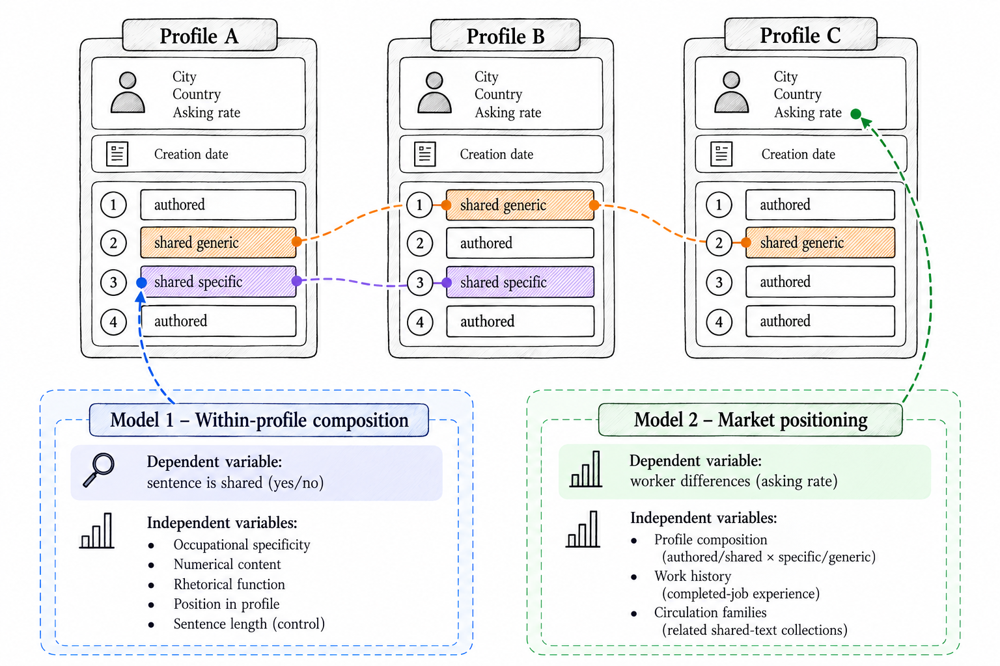

# Introduction

A freelancer's public profile brings together two very different kinds of information.
Completed jobs, recorded hours, and client ratings summarize work carried out through the platform.
The description explains who the worker is, what the worker can do, and why a client should engage them.
The first kind of information is produced through transactions and recorded by the platform.
The second is composed in an editable text field.
Both are visible to prospective clients, but the description is also available to other workers.
A sentence about reliability, expertise, or client satisfaction can become part of someone else's profile without transferring the experience it purports to describe.

This difference creates a puzzle for understanding self-presentation in online labor markets.
Signaling research explains how observable attributes and actions convey information about otherwise hidden qualities [@Spence1973; @ConnellyCertoIrelandReutzel2011].
On labor platforms, accumulated records help clients evaluate service providers they have never met [@HongPavlou2017; @MorenoTerwiesch2014; @Yoganarasimhan2013].
Workers also use profile descriptions to frame their expertise and build a recognizable professional identity [@BlythJarrahiLutzEtAl2022; @Gandini2016].
Yet the wording of those descriptions does not have the same relationship to its sender as a completed-job record.
Reproducing another person's claim is much easier than reproducing that person's work history.
If textual signals are understood only through the cost of acquiring their content, this reproducibility would seem to undermine their informational value.
If verified records supply more credible evidence, it would also seem reasonable to expect text to become less consequential where substantial records are available.

Neither implication follows automatically.
Rhetorical signals can matter without being equivalent to classical costly investments [@SteigenbergerWilhelm2018], and costless communication is not necessarily uninformative [@FarrellGibbons1989].
The unresolved issue is more specific: how does the ability to reproduce other senders' wording reorganize the information carried by textual self-presentation?
A profile can combine independently composed-looking claims with shared assurances.
A recognizable textual frame can circulate among a particular set of workers rather than throughout the market.
What is uninformative as an isolated claim might still be informative as a composition choice or a trace of circulation.
Treating the description as a single individual signal obscures these possibilities.

We call the conjunction of public visibility and inexpensive textual reproduction *copyability*.
Copyability is a property of the platform's information environment, not an allegation about the intentions of a particular worker.
It makes others' self-presentation available as a resource, so that copying becomes one of the practices through which a profile is composed.
Our research question is:
*How do workers compose their profiles on online labor markets where the need to differentiate one's profile and the copyability of others' profiles coincide?*

We investigate this question through computationally intensive theory construction [@BerenteSeidelSafadi2019; @MirandaBerenteSeidelEtAl2022].
Using public Upwork profile records, we construct a corpus of  qualifying sentences from  workers.
Sequence-preserving text-reuse detection identifies shared wording rather than merely common topics.
We then organize the analysis around two models.
*Model 1* examines composition within profiles: which sentences are shared and which have no detected exact match?
*Model 2* examines market position, measured by the posted asking rate, across workers: how are a profile's composition and membership in shared-text circulation families associated with its posted rate, including where verified records are available?
Descriptive circulation and alignment analyses support interpretation of the two models.
A supplementary qualitative analysis of theoretically sampled profiles illustrates what the estimated patterns look like in actual descriptions.

The findings do not support a collapse of textual self-presentation into interchangeable cheap talk.
Exact sharing occurs in  of the measured profiles, but reuse is usually partial.
Within the same profile, occupation-specific wording and numerical content are less likely to be shared; assurances, encounter formulae, and sentences later in the profile are more likely to be shared.
Near-copy comparisons concentrate variation in numerical and occupation-informative tokens.
Across workers, authored-specific composition is associated with higher asking rates and shared-generic composition with lower asking rates.
Circulation-family differences remain after accounting for city and worker covariates.
Most importantly, the shared-generic association does not disappear among workers with substantial completed-job records.
These are cross-sectional associations with workers' asking prices, not demonstrated effects on client choices or realized wages.

We develop these patterns into a process model.
Copyability and differentiation pressure are its conditions, profile composition is its practice, and market position is its outcome.
Profile composition is the combination of two concurrent practices, authoring and copying.
Three propositions state the mechanisms that link the constructs: selective composition, composition and provenance associations with market position, and non-substitution between records and text.
The account distinguishes three components of textual signals: *content*, or what a claim says; *profile composition*, or the profile's combination of shared and non-exact-shared wording; and *provenance*, or the circulation relationships indexed by its shared text.
The distinction does not imply that we can recover a sentence's original author or externally verified source.
It explains why reproducible content can coexist with informative composition and circulation.
Our operational use of “authored” means no detected exact sharing, not demonstrated independent composition.

This account makes three contributions.
First, it establishes copying as a practice of profile composition.
That copyability makes copying possible is close to self-evident, but its consequences have not been examined as part of how self-presentation is composed under signaling.
We show that workers neither compose afresh nor copy wholesale: they combine authoring and copying selectively.
Copyability thereby organizes self-presentation instead of only threatening the credibility of a signal.
Second, we derive more detailed propositions from the findings about how composition is associated with market position.
Authored-specific and shared-generic composition are associated with opposite positions, and circulation families carry information beyond broad geography, occupation, and recorded work.
Textual self-presentation is therefore both individually composed and relationally structured.
Third, we establish non-substitution as a boundary to a reputation-centered account.
Verified records do not make the measured textual associations disappear.
The resulting theory is not that clients reward originality or punish copying.
It is that the informational structure of a copyable profile cannot be reduced either to its words in isolation or to the verified record beside them.

# Conceptual Background

## Signals, Records, and Credentials in Online Labor Markets

Online labor markets connect geographically dispersed workers and clients through digitally represented information [@Horton2010; @LehdonvirtaEtAl2019].
For services that are difficult to evaluate before delivery, clients confront uncertainty about competence, reliability, and fit, and about whether a worker is available at all [@Horton2019].
Because applications are cheap, workers apply widely and many openings never lead to a contract [@KokkodisIpeirotis2023], so clients screen quickly on whatever is visible.
Research on online service markets accordingly examines reputation, standardized information, and provider characteristics in hiring and market outcomes [@HongPavlou2017; @MorenoTerwiesch2014; @AgrawalLaceteraLyons2016].

Signaling theory explains how observable features can help distinguish senders with otherwise hidden attributes [@Spence1973; @ConnellyCertoIrelandReutzel2011].
Work on online labor markets separates assessment signals, whose production requires possessing the quality signaled, from conventional signals, whose link to quality rests on social convention and which any sender can produce [@HolthausStock2018].
The classical expectation is that cost makes signals credible, and platform evidence is consistent with it.
When a platform removed the fee for a certification test, the certification's hiring and price advantage narrowed and workers certified under the new policy were less likely to deliver high-quality work [@BaiGaoGoesEtAl2026].
Employers avoided workers who offered a guarantee deposit that high- and low-quality workers could produce equally well [@GaoLinLiuEtAl2026].
Yet costless communication is not necessarily uninformative [@FarrellGibbons1989].
A free capacity status became informative on one platform because workers' later behavior matched what they had declared [@Horton2019], and rhetorical signals can organize interpretation of a sender without certifying a costly investment [@SteigenbergerWilhelm2018].

Verified work records have a particularly direct relationship to activity on the platform.
A worker cannot acquire a substantial completed-job history simply by writing that another worker has one.
Recorded histories can reduce uncertainty.
Achievement records predict supplier quality, whereas skill credentials do so only under some conditions [@KathuriaEtAl2021].
They are nonetheless neither complete nor free of strategic behavior and evaluation problems [@Tadelis2016; @Rahman2021].
Ratings are inflated and blend heterogeneous skills into one score [@KokkodisIpeirotis2016; @Kokkodis2021], and clients and contractors shape them through relational practices even under double-blind feedback [@Rahman2018].
Their absence is also a practical obstacle: workers without an established record can struggle to obtain the very work through which such a record is built [@Pallais2014; @StantonThomas2016; @LiangHongGu2025].

Whether records displace other cues is an open question.
Group-level cues such as country image matter when a provider has no individual record, and their role fades as individual reputation accumulates [@KanatHongRaghu2018].
A monitoring tool that verified ongoing work reduced employers' preference for experienced workers [@LiangHongGu2025].
The weight placed on any one cue thus appears to depend on what else is verified.
We use *substitution* for the possibility that, as records become available, other information, including the wording of a description, becomes less informative about market position.
We use *non-substitution* for the possibility that records and text are associated with different dimensions of position, so that textual differences persist among workers with similar recorded experience.

## Profile Text as a Signal

Descriptions differ from records because workers can select, order, and frame their claims.
Self-presentation is not simply the disclosure of attributes; it also organizes how an audience encounters them [@Goffman1959].
Freelancers describe services, translate experience into promises of usefulness, and present working styles alongside credentials, while clients read both the claims and the cues that are given off [@BlythJarrahiLutzEtAl2022].
The audience is hurried.
As one interviewed freelancer put it, nobody will spend more than a minute looking at a profile [@PulignanoMuszynskiTapia2024], and the profile overview is the text that also appears in search results [@YueHong2025].
Potential clients assess freelancers largely through the profile [@GussekWiesche2023].
This work is especially important where professional recognition is no longer supplied by a stable organizational affiliation [@BarleyKunda2006; @AshfordCazaReid2018; @PetriglieriAshfordWrzesniewski2019].

A growing body of work finds that the content and style of this text relate to market outcomes beyond what records capture.
Coded self-promotion is associated with higher one-year earnings and ingratiation with lower earnings, while a verified rating is not associated with earnings in the same model [@HolthausStock2018].
Similarity between a profile and a job opening is positively associated with being hired, whereas the feedback score alone ranks applicants barely better than chance [@KokkodisPapadimitriouIpeirotis2015].
Applications that are longer, closer to the job description, and less prototypical of their category are hired more often [@TroncosoLuo2023].
Politeness in pre-contract chat predicts contracting [@DongEtAl2024].
A more analytical writing style in a profile is associated with lower subsequent earnings, and the association is conditioned by ratings, badges, education, and platform hours [@YueHong2025].
The same sensitivity appears on the client side: the length, readability, sentiment, and technical specificity of project descriptions predict how many bids they attract [@AlshalfanMahdikhani2026].

What counts as specific is a matter of fit rather than of quality.
Skills in online labor markets cluster into categories, and diverse skill sets are associated with higher wages than narrow ones [@Anderson2017].
Gig work unbundles occupations into individual skills, so specificity is expressed through what a worker is hired for rather than through a job title [@VanSlagerenHerrmann2024].
Specialized services give freelancers more autonomy over their rates, whereas generalized services face price competition [@PulignanoMuszynskiTapia2024].
Yet more cohesive skill sets are hired more often but earn lower hourly wages [@Kokkodis2023], incongruent skills help in low-skill and hurt in high-skill categories [@FuEtAl2021], and a formal writing style is penalized outside technical occupations [@YueHong2025].
Specificity is therefore not rewarded uniformly; its value depends on occupation, outcome, and audience.

These studies treat text as the property of a single worker.
Each measures what one profile says or how it reads, and none asks whether the same wording appears in other workers' profiles.
That omission is harmless as long as text can be assumed to be composed afresh.
It matters once anyone can copy what others have written.

## Copyable Text: A Puzzle for Signaling

Copyability follows from two properties of the setting.
Digital artifacts are editable and reproducible, and their informational properties are shaped by the systems through which they are represented and accessed [@KallinikosAaltonenMarton2013].
Profiles are also public, so freelancers can read one another's descriptions and observe one another's career paths [@GussekWiesche2024].
Clients, for their part, report noticing copy-pasted proposals and stolen portfolio material and read them as laziness [@BlythJarrahiLutzEtAl2022].
Copyability is not confined to profiles.
Platforms treat leaked test questions as compromised and retire them from evaluation [@ChristoforakiIpeirotis2014].

Classical signaling logic turns this into a puzzle for profile text.
If a signal is easy to fake, all senders will use it, which destroys its informational value [@Nieken2023].
Studies of text in these markets sometimes assume that detailed writing is costly to produce and therefore credible [@AlshalfanMahdikhani2026], without testing whether it is reproduced.
Cheap, widely available signals have been diluted or discounted on platforms [@BaiGaoGoesEtAl2026; @GaoLinLiuEtAl2026], and unlike a badge or a deposit, a reused sentence carries no label that distinguishes it from composed text.
Yet profile text relates to outcomes even alongside verified records.
Whether text that anyone can copy still tells clients something, and what, cannot be settled by studies that measure each profile in isolation.

If wording circulates, it need not circulate evenly.
Online work connects distant participants, but place still matters.
Country image shapes provider outcomes when individual records are thin [@KanatHongRaghu2018], and geographic and social distance remain relevant to exchange [@GefenCarmel2008; @HongPavlou2017; @LehdonvirtaEtAl2019].
Workers also learn to navigate platforms informally, often outside formal organizations [@SutherlandJarrahiDunnNelson2020].
Place, occupation, and the period in which a description was created are therefore plausible dimensions along which wording could be shared.
We treat them as dimensions to examine rather than as expectations, and we do not use them to infer nationality, cultural origins, or who copied whom.

This leaves a broad question that existing work cannot answer and that we pursue with the data rather than with hypotheses: *when self-presentation on a digital labor platform can be copied by anyone who can see it, what does profile text signal?*

# Research Method

## Computationally Intensive Theory Construction

We adopted a data-driven approach that iterates between computational patterns and theoretical interpretation [@BerenteSeidelSafadi2019; @MirandaBerenteSeidelEtAl2022; @Lindberg2020].
Text-reuse detection makes shared wording observable at a scale at which reading profiles alone cannot establish its distribution.
The technique comes from political science, where it traces how bill text moves between legislators and legislatures [@WilkersonEtAl2015; @LinderEtAl2020; @GavaJaquetSciarini2021].
Unlike topic models and other document-level text-as-data methods [@GrimmerStewart2013], which describe the themes that documents share, it identifies the specific passages that recur across documents, and so shows where in a profile reuse occurs and who shares it.
Statistical models then characterize relationships within and across profiles.
Interpretation relates these relationships to signaling, copyability, and circulation.
Consistent with computationally intensive theory construction, the models support theory development rather than a claim of independent confirmatory testing.
The Conceptual Background accordingly sensitizes the analysis without deriving hypotheses.
We develop propositions after presenting the models and robustness checks, keeping the distinction between an estimated relationship and its proposed signaling mechanism explicit.

The analytic sequence in @fig-method has five phases.
We first construct the sentence corpus from the public profiles.
A separate text-reuse phase then detects cross-worker reuse, validates the stored similarity scores, and describes reuse at the sentence, worker, script, and family levels; its output is the input to both models.
The primary analysis estimates Model 1 and Model 2, together with the content, function, position, and variant-alignment descriptions and the verified-record, city, and circulation-family components that inform their interpretation.
The secondary analysis has two parts: a qualitative reading of theoretically sampled profiles and near-copy pairs, which draws its cases from the patterns the models identify and makes their substantive form inspectable, and robustness checks on alternative measurements, samples, and outcomes.
The final phase develops propositions from these results.
This organization separates the two central models from supporting descriptions and qualitative readings.
It resembles the model-to-interpretation progression used in computationally intensive IS studies [@LindbergSchecterBerenteEtAl2024], with a consolidated robustness battery [cf. @SafadiLalorBerente2024].

{#fig-method}

The two models answer different questions at different units of analysis.
A worker-level comparison alone cannot distinguish selective composition inside a profile from differences in who participates in reuse, and a sentence-level comparison alone cannot establish whether the resulting composition is associated with market position.
The two-model design connects these levels without treating them as a single causal sequence.

The process was exploratory and involved revising initial interpretations.
In particular, a few very widely shared passages dominate pair counts much more than distinct adoptions.
Keeping those denominators separate changes the apparent concentration of the repertoire.
Reconstructing sentence identifiers and using endpoint-adjusted mixing baselines also redirected interpretation toward selective composition and structured circulation.
We retain the exploratory outputs in the research audit trail but base the manuscript on the reconstructed data, the two models, and their robustness checks.
Appendix E describes the reproducibility record.
This reflexive account avoids treating the final framing as if it preceded every analytic decision.

## Setting, Collection, and Safeguards

Upwork provides a useful setting because workers present diverse knowledge services through public profiles that combine editable descriptions, asking rates, and platform-recorded work.
The input file contains  worker-profile records.
Data were collected on September 21, 2023, in a single run through public Upwork API endpoints.
A scraper assembled unique worker identifiers from Upwork's public category pages, which are organized by occupational category, subcategory, and occupation.
Because a single listing returns a capped number of results, we partitioned the listings by further filters, such as country and rate group, with the aim of retrieving every public profile.
A profile-detail script then retrieved the public record for each listed identifier.
Work-history retrieval is not part of this project: completed jobs, recorded hours, and ratings are fields of the profile record.

The identifier list contained  unique identifiers after removing  duplicate rows.
For  of them (), the profile endpoint returned an error instead of a profile, most often because the profile was no longer available () and otherwise because it could not be found ().
The remaining  profile records form the input file.

The collection aimed to retrieve every public profile rather than to sample, but we cannot verify its completeness against the platform's own records, so it is not an established census or probability sample of all public workers.
We therefore treat the data as a large retrieved-profile cross-section.
Public accessibility at retrieval is not equivalent to activity, representativeness, or unrestricted permission to redistribute the texts.
No claim that the collection covers every occupation or all active workers is required for the within-corpus analysis.

The retained metadata include posted hourly rate, completed jobs, recorded hours, rating, listed occupations, country, city, and agency affiliation.
The author-confirmed meanings of `created_at` and `updated_at` are the creation and update times of the *profile description*, not account-registration dates.
The latest observed description update is September 8, 2023, thirteen days before the September 21, 2023 collection.
We use the latest observed update as the fixed reference for description-age controls.
The existing computational field called `tenure_yrs` is reported here as description age.
Similarly, a small creation-to-update gap concerns edits to the description, not whether a worker had completed any work when the description was created.

We took several safeguards.
The analysis uses only public profile text and metadata.
Workers are identified by neither platform identifiers nor names, and the paper reproduces no complete description or client name.
We quote only short passages that recur across workers, namely exact-shared sentences and, where we show personalization, near-copy variants.
Because each such passage appears, in identical or near-identical form, in more than one worker's profile, quoting it does not by itself identify any one worker.
We paraphrase unshared, personal, and client material.
Full profiles, identifiers, and case comparisons are internal research materials, not publication supplements.

## Corpus Construction and Reuse Detection

We first apply the original detection pipeline's common-vocabulary filter: a description must contain at least one non-stopword token without digits that occurs more than 100 times in the input corpus.
This retains  profiles.
The filter is an English-oriented preprocessing rule, not a verified language classification.
We normalize whitespace, segment descriptions with a sentence tokenizer, and retain units containing 8–50 whitespace-counted words.
The resulting reuse frame contains  sentences in  profiles.
Counts of words for eligibility and tokens for content analysis use different tokenization rules, documented in Appendix B.

Each sentence is lowercased and represented by a set of word five-grams.
For sentence shingle sets $A$ and $B$, similarity is

$$
J(A,B)=\frac{|A\cap B|}{|A\cup B|}.
$$

This measure preserves local word sequence rather than only thematic vocabulary [@Broder1997; @WilkersonEtAl2015].
We use 240-permutation MinHash signatures and locality-sensitive hashing with 60 bands of four rows to generate candidate pairs, then compute their exact Jaccard scores.
Candidate generation produces  scored pairs;  same-worker pairs are excluded.
We reconstructed the sentence identifiers and re-scored 3,000 randomly sampled candidate pairs.
All matched their saved scores within numerical tolerance.
This verifies the corpus-to-score mapping, not the substantive accuracy of every interpretation of sharing.

The main definition of *exact sharing* is $J=1$: equality of word-five-gram sets across workers.
It is not character-by-character identity.
Punctuation and case normalization, tokenization, and the use of sets can make surface forms differ while their measured sets are equal.
A *script* is a connected component of exact-sharing sentences held by at least two workers.
A sentence is operationally *authored* when it has no detected exact cross-worker match.
This category includes non-exact near-copies and cannot establish independent composition.

Candidate detection is similarity-dependent.
Under the LSH configuration, the probability of becoming a candidate is $1-(1-J^4)^{60}$: approximately  at $J=.3$ and  at $J=.5$, approaching one at higher similarities.
We consequently center inference on exact sharing, use $J\geq .7$ as a model sensitivity check, and use $.5\leq J<1$ for variant alignment.
Low-similarity candidates are not an exhaustive census of weaker reuse.
Nor do unobserved matches outside this corpus establish originality.

The pipeline is computationally intensive.
Exhaustive pairwise comparison of  sentences is impractical, which is why candidate generation uses MinHash and locality-sensitive hashing.
Even from the saved candidate pairs, rebuilding the derived data and fitting both models and the robustness battery takes about 1.5 hours on 16 cores, and the multilevel fits dominate.
Appendix E gives the computing environment and run order.



## Constructs and Measurements

Three components structure the measurements and models below.
*Content* refers to the substance of a sentence: its occupational detail, numerical claims, rhetorical function, and other meanings.
We measure it through occupational specificity, numerical content, and rhetorical function.
*Profile composition* refers to the combination of two practices, authoring and copying, across that content and across the profile.
We observe authoring as sentences with no detected exact cross-worker match (authored) and copying as sentences with an exact cross-worker match (exact-shared).
Neither label implies intent or direction: authored wording can be an adapted template, and shared wording can have been written by the worker who holds it.
We measure profile composition at the sentence level as exact-shared or authored status together with relative position in the profile, and at the worker level as profile composition shares.
*Provenance* refers to the circulation relationships through which shared forms are available and recur.
We measure it through circulation families.
These components can carry different information.
The same assurance can appear in many profiles, but its prevalence within a particular composition and its co-occurrence with other passages can identify a more particular presentation pattern.
The components are the lexicon through which we frame the patterns surfaced by the analysis.
They are not hypotheses derived in advance.
We define content, profile composition, and provenance for this study; treating measured reuse as the observable trace of shared wording follows the text-reuse studies in political science [@WilkersonEtAl2015; @LinderEtAl2020; @GavaJaquetSciarini2021].

They rest on a distinction between *textual reproduction* and *claim portability*.
Textual reproduction concerns whether a form can be duplicated.
Portability concerns the range of workers for whom its claim could remain applicable.
A general communication promise can apply to many workers.
A statement concerning a narrow capability applies to a smaller set.
A personally anchored account of a particular history may apply to fewer still.
Copyability makes reproduction easy in all three cases, but does not make them equally appropriate to adopt.
The distinction directs attention to composition rather than to a binary contrast between original and copied profiles.
A worker can draw on broadly reusable assurances while composing a more specific occupational account, adopt an occupational frame and modify a number, service, or tool, or share a detailed claim intact.
Occupational specificity, personal individuation, original wording, and truth-conditional portability are related but not identical.
We use occupational wording and numerical content as tractable indicators of selective composition, not as direct measures of whether a sentence is true for one worker alone.

@tbl-measures summarizes the constructs, their operationalizations, and the role each plays in the two models.
Copyability and differentiation pressure are scope conditions of the setting, not measured variables, and control variables are listed with Model 2 below.
*Differentiation pressure* is the need to stand out to a hurried audience that can read copy-paste as laziness [@BlythJarrahiLutzEtAl2022]; like copyability, it is drawn from the literature and not measured.
We operationalize *market position* as the posted asking rate in Model 2 and examine ratings and recorded hours as alternative outcomes in the robustness checks.
The content and reuse measures are constructed before the rate models; qualitative judgments are not substituted for them.
Where a measure builds on prior work, the table cites it.
We developed the content measures (occupational specificity, numerical content, rhetorical function) and sentence position for this study, in the manner of text-as-data work [@GrimmerStewart2013], and use the platform fields as recorded.

| Construct | Role | Operationalization | Interpretation and boundary |
|:---|:---|:---|:---|
| Authoring and copying (authored and exact-shared sentences) | Model 1 outcome; Model 2 component | Exact-shared: cross-worker word-five-gram match at $J=1$ [@WilkersonEtAl2015; @LinderEtAl2020]. Authored: no detected exact match | Shared measured form, not verified copying intent or direction; authored includes non-exact near-copies |
| Occupational specificity | Model 1 predictor; content split in Model 2 | Distinct informative word types; informative if used by at least 100 workers and occupational KL divergence is at least .5 bits | Occupational concentration, not uniquely personal truth |
| Numerical content | Model 1 predictor | At least one numeric token under the content tokenizer | Can concern history, quantities, or service promises |
| Rhetorical function | Model 1 predictor | Dictionary moves collapsed to claim-bearing, assurance, encounter formula, or other | Claim-bearing combines identity, credential, capability; estimation label: “individuating claim” |
| Sentence position | Model 1 predictor | Relative position among qualifying sentences: 0 for the first, 1 for the last | Index among qualifying units; does not necessarily equal literal position in the description text |
| Profile composition | Model 2 predictor | Authored-specific, shared-generic, shared-specific sentence shares; authored-generic omitted | Shares sum to one across the four categories |
| Circulation family | Model 2 predictor | Co-adoption components of scripts; dominant family for each sharer | Circulation-based provenance proxy, not an externally verified origin |
| Verified record | Model 2 moderator | Completed-job groups: 0, 1–9, 10–49, 50+ [cf. @Pallais2014; @KanatHongRaghu2018; @KathuriaEtAl2021] | Platform-recorded work, distinct from textual claims about experience |
| Market position | Model 2 outcome | Posted asking rate: log posted hourly rate, USD 3–500 [cf. @MorenoTerwiesch2014; @Kokkodis2023] | Asking price, not realized wage or observed client valuation |

: Constructs and measurements {#tbl-measures}

**Specificity.**
We estimate a lexicon on sentences with no detected sharing at $J\geq .5$, counting each worker once per word type.
For a word's users, we compare the distribution of first-listed occupations with the corresponding worker baseline using Kullback–Leibler divergence.
Types used by at least 100 workers and carrying at least .5 bits of divergence, excluding numeric types, are informative.
The lexicon contains  informative types.
Sentence specificity is the number of distinct informative types, modeled as $\log(1+\text{specific types})$ in Model 1.
A sentence is specific in Model 2 if it contains at least one informative type.
Estimating the lexicon on less-shared text reduces the possibility that a circulating template manufactures its own occupational specificity, but does not independently validate the construct.

**Function.**
A transparent, ordered dictionary assigns moves before they are collapsed for Model 1.
Identity, credential, and capability moves form the reference group; character and process moves are assurances; encounter moves include invitations and courtesies.
Agency and unmatched moves fall in “other” in the model.
We use “claim-bearing” as readable shorthand for the reference grouping, not as a change to the estimation labels.
The ordered rules can privilege an assurance keyword over an occupational or testimonial function in a mixed sentence.
We retain this dictionary measurement and document supplementary disagreement diagnostics between the dictionary and the sentence codes from the qualitative analysis, without treating either as a benchmark.

**Families.**
To identify passages that recur together, scripts with at least five adopters are linked when at least three workers hold both and the overlap coefficient—co-adopters divided by the smaller script's adopter count—is at least .5.
Connected components form multi-script families; unlinked scripts retain their own family identifiers.
A worker's dominant family covers the largest number of that worker's shared sentence instances, with ties favoring the family represented by a larger script.
This assignment summarizes circulation but does not represent all memberships of workers who combine several families.
Locality, cohort proximity, and price-peer comparisons describe the relational structure of reuse separately from the asking-rate model.

## Model 1: Within-Profile Composition

Model 1 estimates which qualifying sentences are shared within the same description.
For sentence $i$ in worker profile $j$, the main specification is

$$
\operatorname{logit}[Pr(S_{ij}=1)]=\alpha_j+
\beta_1\log(1+K_{ij})+\beta_2N_{ij}+
\boldsymbol\beta_3'\mathbf F_{ij}+\beta_4R_{ij}+\beta_5\log (L_{ij}),
$$

where $S$ denotes exact sharing, $K$ counts distinct occupation-informative types, $N$ indicates a numeric token, $\mathbf F$ represents rhetorical function, $R$ is relative position in the profile (0 for the first qualifying sentence, 1 for the last), and $L$ is word count.
Worker fixed effects $\alpha_j$ absorb worker-level differences shared by all sentences in a profile.
The model therefore addresses composition, not the between-worker question of who shares text.
Length controls distinguish content and position from the mechanical difficulty of reproducing a longer sequence.

We estimate a binomial fixed-effects logit with worker-clustered standard errors.
Profiles with at least two qualifying sentences contribute  eligible units; identification in the logit comes from  sentences in  mixed profiles containing both shared and non-exact-shared units.
Entirely shared and entirely unshared profiles do not identify its slopes.
A worker-fixed-effects linear-probability specification examines whether the principal composition pattern depends on the logit link.
Its eligible sample includes invariant-outcome profiles and is therefore larger than the logit's identifying sample.

## Model 2: Composition, Circulation Families, and Asking Rates

Model 2 uses  workers with eligible asking rates and observed description age.
For each worker, the four composition shares distinguish authored/shared wording and specific/generic content.
We omit authored-generic share and estimate three forms of the same worker-level model: composition without record interactions (2a), composition with record interactions (2b), and a multilevel form adding city and circulation-family effects (2c).
The general form is

$$
\begin{aligned}
\log (r_j)={}&\theta_1 A^S_j+\theta_2 C^G_j+\theta_3 C^S_j
 +\sum_{k=1}^{3}\left(\delta_k A^S_j+\eta_k C_j\right)D_{jk}\\
&+\mathbf x_j'\boldsymbol\gamma+\mu_{c(j)}+\lambda_{o(j)}
 +u_{\operatorname{city}(j)}+Q_jv_{\operatorname{family}(j)}+\varepsilon_j.
\end{aligned}
$$

Here $A^S$ is authored-specific share, $C^G$ shared-generic share, $C^S$ shared-specific share, $C=C^G+C^S$ total shared share, $D_k$ the three nonzero-job indicators, and $Q$ an indicator that the worker has any exact sharing.
The common $\eta_k$ interaction shifts the shared-generic and shared-specific slopes equally within a record group.
It is a specification restriction, not an estimate of separate record interactions for each shared type.
Form 2a excludes the interaction terms; forms 2a and 2b exclude random effects.

Controls include completed-job groups, $\log(1+\text{jobs})$, $\log(1+\text{hours})$, rating bands, a five-degree-of-freedom natural spline of description age, agency affiliation, number of listed occupations, log description characters, and log qualifying-sentence count.
Country and first-listed-occupation effects account for broad market differences.
Countries with fewer than 200 workers in the qualifying frame, together with missing country, are pooled as “Other.”
Missing occupation has its own category; city groups are nested in country, with country-specific missing-city groups.

Forms 2a and 2b use absorbed country and occupation effects and country-clustered standard errors.
Form 2c is fitted by maximum likelihood, adding a city random intercept and a family random effect that applies only to sharers.
It contains  exact sharers,  represented families, and  city groups.
Its fixed-part standard errors are model-based, not country-clustered.
We report the family variance relative to family-plus-residual variance, $\sigma_v^2/(\sigma_v^2+\sigma_\varepsilon^2)$, and compare fits with and without the family component.
This ratio excludes city variance and is not the share of total asking-rate variation explained by provenance.

Composition coefficients describe a unit change in a share relative to the omitted category.
Reporting $100[\exp(\theta)-1]$ therefore gives a hypothetical contrast between an entirely one-type profile and an entirely authored-generic profile.
It is not the effect of copying one sentence or the change expected for a typical worker.
The models describe conditional asking-rate associations.
They do not observe client recognition of copying, client valuation of prose, or causal consequences of adopting a template.

## Supplementary Qualitative Analysis

We selected 150 full profiles across ten theoretical cells to inspect typical composition, shared-specific openings, heavily shared descriptions, experienced sharers, different computational assembly patterns, family-price contrasts, and authored-premium contrasts.
The material contains 1,401 qualifying sentences, 100 profile-nearest non-exact variants, and 100 separately sampled near-copy pairs.
The latter are divided equally between same and different first-listed occupations.
Appendix C details the sampling and procedure.

The lead author coded the sampled material using a codebook with ordered decision rules and discussed the results with the other authors.
Coding proceeded in three passes (Appendix C).
In the first, sentence moves, portability judgments, and profile-level language and positioning codes were assigned while computed sharing flags, sampling cell, asking rate, experience, rating, and country were hidden.
In the second, with reuse information shown, near-copy variants, profile assembly, the location of claim-bearing material, and coherence were coded.
In the third, the 100 separately sampled near-copy pairs were coded for edit type and fit.
A full-context review then produced 43 documented amendments to individual codes, with the initial judgments retained.
One person who knew the research question and theoretical expectations did all of the coding, and the final judgments are not fully blinded.
The coding is therefore neither independent nor tested for reliability, and it is not a gold standard against which the computational measures can be validated.
It did not change the computational measurements or re-estimate either model.

We use checked excerpts and paraphrased contextual readings to illustrate the models.
Because profiles were selected in response to computational results—and some using asking-rate contrasts—the readings cannot independently confirm those same associations or estimate population prevalence.
Their role is to show how reusable passages function within descriptions, and to qualify categorical interpretations where appropriate.
The principal evidence remains the corpus analysis, Models 1 and 2, and their robustness checks.

# Findings

## A Substantial, Partially Used Repertoire

Exact sharing involves  workers, or  of the -worker reuse frame.
There are  scripts.
This is substantial circulation without a universally adopted platform text: the largest script has  distinct adopters.
The second most widely shared sentence is a full pitch, not a stock phrase, and appears in the descriptions of  workers:

> Whether you're trying to win work, list your services or even create a whole online store — I can help!

Most scripts are far smaller, though:  are dyadic.
Reuse contains a long tail of small-scale sharing as well as more visible recurring passages.

The distinction between pairs and adoptions is consequential.
The 100 most-adopted scripts account for  of exact sentence pairs but only  of distinct worker–script adoptions.
A widely adopted passage generates many pairwise links, so pair concentration should not be interpreted as the fraction of workers drawing on a tiny repertoire.
Large scripts are useful for inspecting recurring language, but do not exhaust the phenomenon.

Within profiles, reuse is generally partial.
Among exact sharers, the median is  shared qualifying sentences,  of qualifying sentences, and  of qualifying words.
Shared material also tends to appear later.
For profiles with at least three qualifying units, exact-sharing rates are  at the first position,  in middle positions, and  at the last.
In  of mixed profiles, shared sentences occur later on average than non-exact-shared sentences.
@fig-sharing shows the spread.
These descriptive gradients motivate a within-profile model; they do not yet distinguish position from content or length.

{#fig-sharing}

## Circulation Is Relationally Structured

@fig-circulation compares similarity bands using worker pairs, rather than counting every sentence match as a separate worker relationship.
Relative to random mixing of the same pair endpoints, exact-sharing lifts are  for city,  for country, and  for first-listed occupation.
The city gradient is especially pronounced as similarity increases.
Geographic concentration is therefore not just a consequence of the size of a country in the corpus, and occupational organization is not absent.

{#fig-circulation}

Structure remains even among pairs sharing only lexicon-generic sentences: country lift is  and occupation lift .
Generic content does not imply socially unrestricted circulation.
Among same-city exact-sharing pairs, description-creation dates are within 30 days of one another  times as often as in the matched random comparison, and within seven days  times as often.
These dates concern description creation, not necessarily entry onto the platform.
Exact-sharing partners' log asking rates correlate , compared with  when the partner is replaced by a randomly selected worker from the same country–occupation stratum.

Together, these findings support treating shared wording as a relationally organized resource.
They are compatible with local learning environments, common organizational materials, or shared exposure to examples.
They do not identify a tutorial, onboarding process, agency, or person as the origin.
This distinction matters for Model 2: circulation families can be informative about asking-rate differences even when their external sources and transmission channels remain unknown.

## Model 1: Selective Profile Composition

@tbl-model1 reports the within-profile estimates.
Occupational specificity has an odds ratio of  per one-unit increase in $\log(1+\text{distinct informative types})$.
Sentences containing a numeric token have an odds ratio of .
Both are much less likely to be exact-shared, relative to other sentences in the same profile and conditional on function, position, and length.
These are odds relationships, not percentage-point changes in sharing probability.



The contrast is easiest to see within a single description.
One customer-service profile opens with more than a decade of healthcare and telecommunications experience and a list of named clients, then presents attributed testimonials from former managers.
None of these sentences has a detected exact match elsewhere.
Its final two sentences do, and are held by  and  workers respectively:

> We could always start off with a small project with shared risk and then keep going if you're happy with my work.
> Chances are that you'll be more than happy.

The evidentiary account carries the profile's biographical and occupational content.
The close is a risk-reversal offer that would fit almost any worker, and it does not replace the account that precedes it.

Dictionary-coded assurances have  times the sharing odds of the reference claim-bearing group, and encounter formulae  times the odds.
Assurances promise a disposition rather than a capability:

> I guarantee you will be satisfied with my work!
> I take pride in leaving all of my clients satisfied.

Both sentences come from one graphic and web design profile, where they are held by  and  workers.
Encounter formulae invite contact and could close almost any description.
This one is held by  workers and ends the profile of a Microsoft-platform consultant whose preceding sentences list certifications, systems, and project history:

> Please contact me so we can discuss how we can work together to fully meet your business needs!

Sharing also rises with position in the profile: a profile's last qualifying sentence has  times the odds of being shared that its first qualifying sentence has (relative position 1 versus 0).
The estimates preserve the positional pattern after accounting for content and length.
Because the model compares sentences of the same profile, this is not merely a contrast between different workers' language, countries, or experience levels.
An architecture profile shows the gradient.
Its opening sentences describe services, clientele, and ambitions, and none is shared.
A shared testimonial lead-in, held by  workers, then introduces attributed client quotations:

> But don't just take my word for it!

The profile ends with two further shared sentences, held by  and  workers:

> I am excited to collaborate with you and bring your vision to life.
> Let's work together to create something truly extraordinary!

The lead-in takes its function from the attributed evidence it introduces, not from its wording.

The pattern is selective rather than categorical.
Specific shared sentences are present, and some unshared evidence appears late.
The model estimates a relative propensity within mixed profiles, not a rule that all expertise is unshared or all closings are generic.
“Authored” also remains an operational label: a non-exact match can be an adapted template.
The lower sharing odds indicate differentiated use of available wording, not demonstrated original authorship of every claim.
Exceptions are easy to find.
One Shopify developer's description consists entirely of exact-shared sentences, including a duration claim and a narrow specialization, held by  and  workers respectively:

> Over the last 5 years I have been working as a Shopify developer.
> I am specialized in Shopify front-end, back-end and Shopify speed optimization.

Because entirely shared profiles carry no within-profile variation, they do not contribute to the logit's slopes.
They show what the shared-specific category contains, not that the estimated odds ratios fail.

Variant alignments provide a complementary view.
In  sampled pairs with $.5\leq J<1$, numerical tokens and occupation-informative tokens are substituted or deleted at rates of  and , respectively.
The corresponding rates are  for other content words,  for pronoun/voice tokens, and  for function words.
These are token-level rates on one aligned side, not the percentages of pairs containing each kind of variation.
They show where wording differs within recurring forms without identifying the direction or sequence of an actual edit.

Near-copy pairs show what such variation looks like.
In one recurring communication sentence, a field naming the worker's service is inserted into otherwise identical wording:

> We always prefer to keep our work transparent … \
> We always prefer to keep our *web development & application development* work transparent … \
> We always prefer to keep our *CRM development & consultation* work transparent …

An assurance label is numeric in one profile and refers to client reviews in another:

> *100% satisfaction*: I focus on providing value to all of my clients and earning their trust. \
> *Client reviews*: I focus on providing value to all of my clients and earning their trust.

The same personalization appears at the scale of a description within a recognizable designer frame.
Two sampled profiles share an originality pledge held by  workers:

> I believe in creating original, engaging design solutions that resonate with your audience and are functional based on your unique needs.

Their openings, which have near but not exact matches elsewhere in the corpus, differ in the experience they claim:

> I am a full time freelance graphic designer with over *15 years* of professional experience … \
> Hi, I am full time freelance graphic designer and illustrator with over *3 years* of professional experience …

This is a contrast between sampled descriptions, not an observed change from one to the other; the second profile's nearest opening already contains its own shorter duration.
Such cases illustrate the alignment results without introducing a separate central theory of slots or assuming that the inserted claims are true.
Nor are slots always refilled to fit.
The following sentence is held by  workers, and the sampled pairs show it, in exact or near-exact form, under first-listed categories such as Admin Support and Accounting & Consulting:

> I'm a developer with experience in building websites for small and medium sized businesses.

First-listed category is only a coarse check on what a worker does, so the coding flags such pairs as category-discordant, not as misrepresentation.

## Model 2: Composition and Circulation-Family Differences

### Composition Is Associated with Market Position

@tbl-model2 presents the three forms of Model 2.
Without record interactions, a full-unit authored-specific contrast is associated with  in asking rate relative to authored-generic composition.
The shared-generic contrast is , and the shared-specific contrast .
Each coefficient conditions on recorded work, description characteristics, agency affiliation, and country and occupation effects.
These contrasts summarize the scale of the fitted composition slopes; most sharers do not have descriptions consisting entirely of shared sentences.



The key distinction is not simply between specific and generic words.
Authored-specific composition is positively associated with asking rate, whereas shared-generic composition is negatively associated with it.
The latter remains the strongest and most stable textual discount.
Shared-specific composition also has a negative coefficient in the main specification, but its sign changes under a stricter specificity rule.
A universal discount for shared expertise is therefore not warranted.

The contextual material helps interpret what the composition can accompany.
Two descriptions were selected as an extreme asking-rate contrast within the same computational family.
Both contain a block of recurring virtue sentences about value, trust, over-delivering, and kindness, including:

> Over-delivering: this is core to my work as a freelancer.
> My focus is on giving more than what I expect to receive. …
> Kindness: one of the biggest aspects of my life that I implement in every facet of my life.

These sentences are held by , , and  workers.
One profile, with a posted rate of USD  per hour, surrounds the block with an extensive service offering and affordability language.
The other, at USD , places it among specialist outcome positioning, named-client references, and testimonial material.
Common wording thus coexists with different overall positioning.
Because the cases were selected using price information, this comparison cannot independently explain their rate difference or establish a causal effect of surrounding prose.

Shared assurances can also contain substantively useful coordination information.
A graphic design profile combines occupational material with a shared working-style policy:

> I always reply within 24 hours if we don't have an on-going project.
> You will be warned about any delays, vacations and emergency situations beforehand.

These sentences are held by  and  workers, and a second sampled profile reproduces much of the same frame alongside different service material.
Other passages in the frame concern communication, delays, and support arrangements.
Their reuse does not make them meaningless.
This is consistent with a negative asking-rate association that need not be interpreted as clients detecting and penalizing copying.
The model identifies composition-linked position, while the cases show some of the practical functions served by that composition.

### Circulation Families Add Information Beyond City

The multilevel form attributes variance  to circulation families,  to city, and  to the residual.
The family-to-family-plus-residual ratio is .
Adding the family component yields a likelihood-ratio statistic of approximately  against the otherwise comparable city model.
The component is consequently not reducible to the modeled city intercept.
Its interpretation remains conditional on the specified controls, dominant-family assignment, and random-effects assumptions.

The composition relationships also remain in the multilevel form.
For the zero-job reference group, full-unit contrasts are approximately  for authored-specific,  for shared-generic, and  for shared-specific composition.
These should be compared with the zero-job coefficients of the interaction fixed-effects form, not directly with the average slopes of form 2a.
The attenuation of the shared-generic coefficient after adding families is compatible with part of its association being linked to circulation, but is not a causal decomposition.

Recognizable frames make these families inspectable.
One of the most widely held is the “win work” sentence quoted above.
It appears in sampled website-development and logo-design descriptions.
In the near-copy pairs it recurs, sometimes truncated or extended, under first-listed categories as different as Writing and Data Science.
The selected profiles also include repeated virtue blocks, designer introductions, communication policies, and organizational service accounts.
Such forms could circulate through common examples, agencies, or learning resources.
We have not verified those origins.
A family component is evidence of asking-rate similarity among computationally related holders, not evidence that clients recognize a template source or that an identified source causes a price position.

### Verified Records Do Not Eliminate the Shared-Generic Association

The interaction form addresses whether textual associations become negligible when platform records are available.
@fig-records shows full-unit contrasts within completed-job groups.
Shared-generic composition is associated with , , , and  in asking rate in the zero, 1–9, 10–49, and 50+ groups, respectively.
The association persists rather than converging toward zero.
Its magnitude is greater in the 50+ group than in the zero-job group, but it does not widen monotonically across every group.

{#fig-records}

The authored-specific contrasts are less precisely estimated in some record groups.
Non-substitution should therefore not be read as an assertion that every text coefficient is equally strong at every experience level.
The narrower result is that the robust shared-generic association survives alongside substantial verified records.
This rejects a simple disappearance pattern in the observed cross-section, not every possible causal model of reputation and presentation.

Three profiles with substantial completed-job records show how this coexistence looks on the page.
Their descriptions invoke platform achievements, qualifications, or client evidence while retaining shared occupational, virtue, or contact passages.
An SEO specialist with  completed jobs opens with a claim of tens of thousands of platform hours and lifetime five-star ratings, then continues with shared sentences held by  and  workers:

> I am a high-end SEO expert and specialized in increasing the amount of traffic to websites.
> My expertise lies in ecommerce, WordPress, Joomla, Shopify, Wix and local SEO.

A Microsoft-platform consultant with  completed jobs invokes platform status, certifications, and a lengthy specialist history, and also uses shared migration language, here held by  workers:

> I have also a lot of experience with migration from SharePoint on-premise to SharePoint online (Office 365).

A UX designer with  completed jobs, the higher-priced profile of the virtue-block pair above, refers to client evidence in wording held by  workers:

> The client reviews and feedback on my profile are immensely important to me and the value that I provide.

We do not assume that every textual record claim has been independently verified.
The platform metadata establish that reusable self-presentation is not confined to workers without a completed-job record.
The cases illustrate coexistence on the page; the record-group model supplies the association.

## Robustness and Outcome Triangulation

@tbl-robustness consolidates an eleven-entry battery: the main baseline, seven changed rate specifications, the Model 1 linear-probability check, and two alternative worker outcomes.
The changed specifications broaden sharing to $J\geq .7$, retain sentences of at least 15 words, exclude agency members, tighten specificity, restrict description-edit timing, restrict geography, or exclude descriptions with at least 90% shared qualifying sentences.
Three checks also refit the family component.
Appendix D reports sample sizes and coefficient-level detail.



The principal composition pattern is retained across the applicable checks.
Authored-specific composition remains positively associated with asking rate, shared-generic composition remains negatively associated, and the shared-generic contrast remains negative in the highest completed-job group.
These results do not depend solely on brief formulae, agency membership, or the most heavily shared descriptions.
Family-to-family-plus-residual variance remains approximately  with the broader sharing threshold and  after excluding agency members.

Two qualifications matter.
First, with the stricter specificity rule, shared-specific composition is associated with approximately , rather than a discount.
The distinction between authored-specific and shared-generic composition is robust; a general copied-expertise discount is not.
Second, in the within-one-day edit subset, the family ratio is smaller, approximately , although the comparison with the no-family model still yields a likelihood-ratio statistic of approximately .
This subset contains  Model 2 workers.
The shared-generic contrast remains negative, including  in the 50+ job group.
The subset limits the role of later recorded description edits, but cannot establish that the text was written before any work record existed.
Neither an entry-stage chronology nor a within-worker widening claim follows from it.

The alternative outcomes give a different perspective on market position.
Among rated workers with at least five completed jobs, shared-generic composition is positively associated with ratings below 4.8 (OR approximately ); authored-specific composition has no discernible association with this outcome.
In the hours model, conditional on asking rate and the remaining controls, a full-unit shared-generic contrast corresponds to approximately  more in $1+\text{recorded hours}$.
This is compatible with lower-price, higher-volume positioning rather than simple exclusion from work, but cumulative hours cannot identify demand, productivity, or service quality.
These checks support a bounded segment interpretation and do not convert asking-rate associations into causal client responses.

# Theory Development

The two models jointly establish three empirical regularities: within-profile composition is selective; textual composition and circulation families are associated with market position; and the shared-generic association does not disappear where verified records are available.
@fig-theory organizes these regularities and their interpretation as a process model.
Copyability and differentiation pressure are the conditions of the setting.
Copyability, defined above, makes others' wording available as a resource.
Differentiation pressure is the need to stand out to a hurried audience that can read copy-paste as laziness [@BlythJarrahiLutzEtAl2022].
We treat both as conditions of the setting and do not measure either.
Profile composition, the combination of authoring and copying within a description, is the practice through which workers respond to them.
Market position, operationalized as the posted asking rate, is the outcome.
The propositions are drawn as the arrows between constructs because each states the mechanism that links them.
Verified records are not a condition of the setting: many workers have none, and for them the description is much of what a client can read.
We therefore show them as a second practice, reputation building, alongside profile composition.
Unlike wording, a record cannot be copied.
Proposition 3 asks whether the textual associations persist across record groups.
Circulation families describe how copied wording is distributed across profiles, so the model shows them as a property of copying.

![A process model of profile composition under copyability. Boxes are constructs; the arrows are the propositions, which state the mechanisms linking them. Copyability and differentiation pressure are conditions, authoring and copying are concurrent practices whose combination is the profile composition, and circulation families are a property of copying that spans profiles. Reputation building, observed as verified records, is a second practice that cannot be copied; P3 states that the P2 associations persist across record groups. The diagram summarizes proposed relationships, not an identified causal path model or a temporal sequence.](analysis/output/paper/figures/theory.png){#fig-theory}

The model is a process model in a limited sense.
It specifies conditions, practices, and an outcome, not an ordered sequence of events.
Authoring and copying are concurrent practices that vary in degree within one profile.
A cross-section cannot order them in time, and the created and updated timestamps describe whole descriptions, not individual sentences.
The three components introduced in the Constructs section map onto the model.
Content is what the practices act on.
Profile composition is the combination of authoring and copying that results.
Provenance is the circulation relationships that copied wording indexes, shown in the model as a property of copying.
The proposed mechanisms concern differentiation, claim fit, and circulation environments.
They are interpretations of the computational evidence, not directly observed costs, sources, or audience inferences.

## Selective Composition of Profiles

Under these conditions a worker can author wording, copy it, or combine both.
*Profile composition* is the combination of the two practices, observed as authored and exact-shared sentences (see Constructs and Measurements).

Copyability makes broadly applicable language available without requiring a worker to compose its wording anew.
It does not make all claims equally fitting for all workers.
The within-profile estimates show that occupational detail and numerical content are associated with less exact sharing even when general worker differences are absorbed.
Assurances and encounter formulae are associated with more sharing; sharing becomes more likely later in the profile.
Alignment results also locate variation disproportionately in occupation-informative and numerical tokens.

These patterns suggest a composition mechanism.
Workers can economize on the reusable portions of presentation while devoting more individual formulation or adaptation to claims that narrow their services and histories.
The relevant unit is not an original profile opposed to a copied one.
It is a profile in which different kinds of claims have different relationships to the circulating repertoire.
Composition can therefore retain differentiation even when some of its content is common.

A cost-based signaling interpretation is consequently possible without treating the copied words themselves as a costly investment.
Composing a fitting account of capabilities and experience may require knowledge, effort, and the ability to substantiate claims.
The potential cost lies in developing and fitting a presentation to the sender, rather than in acquiring exclusive access to a sentence.
This is an interpretation to be developed from the composition pattern, not something text similarity directly observes.

**Proposition 1—Selective profile composition.**
*Under public copyability and pressure to differentiate, workers preferentially use non-exact-shared wording for occupationally specific and quantified claims, and share more of the wording that appears later in a profile, while drawing more heavily on shared wording for assurances and encounter formulae.
Within recurring forms, occupational and numerical elements are comparatively frequent sites of variation.*

The proposition also addresses why composition is mixed.
Copyability alone does not explain why workers author anything, and differentiation pressure alone does not explain why they copy.
In the data, most profiles contain no detected exact sharing, and among those that do, reuse is usually partial.
Together they make selective composition the plausible response: copy what is portable, and author what must fit.
The proposition describes a tendency, not a prohibition.
It is consistent with detailed shared capabilities and person-specific claims that occur late.
Occupational specificity narrows applicability without necessarily identifying one person, and a copied history claim can be applicable to more than one worker.
The theoretical point is differential composition, not the impossibility of reproducing specific language.
Nor is specificity rewarded uniformly elsewhere in the literature.
More cohesive skill sets raise hiring but lower hourly wages [@Kokkodis2023], and incongruent skills help in low-skill and hurt in high-skill categories [@FuEtAl2021].
We therefore read composition as differentiated fit, not as a quality ranking.
Similarly, the potential effort of composing an appropriate account is not measured by the absence of an exact match.
The observed composition supports investigating where signaling costs may reside without claiming that the dataset measures those costs directly.

## Composition and Provenance as Informational Dimensions

In @fig-theory, P2a and P2b link profile composition to market position, and P2c links circulation families, a property of copying that spans profiles because it is the co-adoption structure of the wording that copying draws on, to the same outcome.
Model 2 indicates that content and operational authorship should not be collapsed.
Occupationally specific composition has different asking-rate associations depending on whether its wording is shared, while the shared-generic category carries the most stable discount.
A single measure of textual specificity would conflate these combinations; a single reuse indicator would conflate a profile with a small shared close and one dominated by shared assurances.

Earlier work associates conventional signals that any sender can produce with weaker outcomes, for example ingratiation with lower earnings [@HolthausStock2018].
This is consistent with, though it does not explain, the discount we find for shared generic wording.

The family component adds a relational dimension.
The geographic, occupational, and cohort patterns show that generic forms can circulate through bounded environments even though their meanings are broadly applicable.
A worker's shared wording consequently locates the profile in a repertoire that is not randomly distributed across workers.
Family-linked asking-rate differences remain after accounting for city and measured worker characteristics.
Shared content need not distinguish individual competence to be informative about a presentation environment and its associated market position.

**Proposition 2—Composition and provenance associations.**
*In copyable self-presentation, (a) authored-specific composition is associated with an asking-rate premium, (b) shared-generic composition is associated with an asking-rate discount, and (c) circulation-family membership provides additional information about market position beyond content composition, recorded work, and broad geographic and occupational differences.*

Here “premium” and “discount” name conditional associations against the authored-generic reference, not rewards or penalties imposed by clients.
The provenance part is also deliberately circulation-based.
Families may reflect imitation of salient models under uncertainty [@DiMaggioPowell1983; @HaunschildMiner1997], recurrent genres of self-presentation [@YatesOrlikowski1992; @OrlikowskiYates1994], peer learning [@SutherlandJarrahiDunnNelson2020; @GussekWiesche2024], organizational texts, common exposure, or other unobserved environments.
That literature concerns organizations and communities.
Adopting wording in a profile requires no investment, so imitation may operate with fewer barriers among individual workers.
We cannot separate these readings with the present data.
External-source tracing would distinguish these possibilities, but the observed family association does not require us to declare one verified origin now.

The signaling interpretation is that information can survive copying in two ways.
First, what is selected, fitted, and placed around shared wording can distinguish a composition.
Second, shared wording can carry relational information because not everyone encounters and adopts the same repertoire.
Reuse may thus pool workers by presentation environment rather than simply render them indistinguishable.
This interpretation does not require every client to detect a copied sentence or know where it came from.
It also leaves open how much of the association reflects worker positioning, client sorting, or common underlying characteristics.

## Non-Substitution Between Records and Text

Verified records enter the model as reputation building, a second practice beside profile composition, and Proposition 3 relates them to the market-position associations in Proposition 2.
They are produced through platform activity and, unlike wording, cannot be copied.
Verified records and textual composition are different informational objects.
A completed-job count records past platform work.
A description frames the offering and can position it relative to client needs, service scope, and price.
If text only compensated for the absence of verified evidence, its asking-rate associations should become weak where records are substantial.
Instead, the shared-generic association persists across all completed-job groups and is not smaller among the most experienced group than among workers with no completed jobs.
Other work finds that individual records can displace coarser cues as they accumulate [@KanatHongRaghu2018] and that records lose part of their premium when other verification becomes available [@LiangHongGu2025].
Our result concerns text composition and market position, and says nothing about hiring.

**Proposition 3—Non-substitution.**
*The asking-rate association of shared-generic self-presentation persists across verified-record groups: substantial platform-recorded work does not eliminate the textual association with market position.*

This is not a proposition about inevitable individual career change.
The evidence compares workers in a cross-section, and the description-timing subset does not recover their earlier work records.
The market-position result is narrower and more robust: records and text coexist, and record availability does not make the shared-generic association disappear.

Taken together, the propositions shift attention from whether copied words are credible in isolation to how copyability, together with pressure to differentiate, shapes profile composition and how that composition and its circulation are read in market position.
Content is reproducible, but the informational structure of its composition and circulation is not exhausted by that fact.
The account retains a role for signaling while specifying what the description can convey beyond an exclusive claim to its wording.

# Discussion

We asked what profile text signals when anyone who can see it can copy it.
In this Upwork cross-section, information survives where exclusivity does not.
Exact sharing is common but partial: workers combine authoring and copying selectively, and the copied wording circulates through bounded environments.
These differences are associated with market position, including among workers with substantial verified records.
The evidence consists of cross-sectional associations with posted asking rates.
It does not show effects on client choices, the cost of writing, or who copied whom.

## Implications for Signaling Theory

The classical argument holds that a signal that is easy to fake will be used by all senders, which destroys its informational value [@Nieken2023].
Work on text in online labor markets has sometimes sidestepped the problem by assuming that detailed writing is costly and therefore credible [@AlshalfanMahdikhani2026], and platform evidence shows cheap, widely available signals being diluted or discounted [@BaiGaoGoesEtAl2026; @GaoLinLiuEtAl2026].
Our results suggest that for copyable text the sentence is the wrong unit.
What differs among workers is the composition of a profile: which claims are copied from wording in circulation, which are authored or adapted, and which circulation family the copied wording belongs to.
Information survives copying in composition and circulation, not in the exclusivity of wording.
In the process model, copyability and differentiation pressure make profile composition a practice, and it is the composition, not the individual sentence, that is associated with market position.
We therefore extend the account of rhetorical signals [@SteigenbergerWilhelm2018] by making the relationship among senders empirically visible, and we link the informational properties of digital artifacts [@KallinikosAaltonenMarton2013] to the organization of self-presentation.

This differs from the signals in the platform studies cited above.
A certification badge or a guarantee deposit is a discrete token whose value depended on who held it [@BaiGaoGoesEtAl2026; @GaoLinLiuEtAl2026].
A shared sentence instead carries content that can fit or misfit a profile, bears no label distinguishing it from composed text, and is distributed unevenly across workers and places.
Assessment items can be retired once they are compromised [@ChristoforakiIpeirotis2014], whereas our data contain no information on whether platforms police profile text.
If a cost interpretation is warranted, the cost lies in developing and fitting a presentation to the sender, not in obtaining exclusive access to a sentence, and our data do not measure it.
The account does not require clients to detect sharing.
It requires only that composition and circulation are associated with market position, and it leaves open how much of that association reflects worker positioning, client sorting, or common underlying characteristics.

The results also bear on whether verified records displace other cues.
Group-level cues such as country image fade as individual reputation accumulates [@KanatHongRaghu2018], and employers' preference for experienced workers declined when a monitoring tool verified current work [@LiangHongGu2025].
Extending that logic to text would predict that its association with market position weakens as records accumulate.
We find instead that the shared-generic association persists across all completed-job groups (@fig-records).
The comparison is not like for like: the cue is text composition and not country image, the outcome is asking rate and not hiring or survival, and the design is cross-sectional.
We read the result as records and text informing different dimensions of position.
A record documents past platform activity without specifying the clients, service configurations, or price positions to which a profile is addressed.
This does not make records unimportant.
Ratings are inflated and blend skills into one score [@Kokkodis2021; @Rahman2018], and those limits leave room for other information.
The association also differs in size across record groups without a monotonic pattern, and related work finds that text effects are conditioned by ratings and badges [@YueHong2025].
Our claim is therefore one of persistence, not of independence from records.
A broader theory of platform signaling should ask which textual dimensions remain informative alongside records, rather than presuming that credibility transfers entirely to verified metrics.

## Implications for Research on Profile Text and Self-Presentation

Research that uses profile text as a measure of worker attributes typically treats each text as composed afresh.
Examples include similarity to a job opening [@KokkodisPapadimitriouIpeirotis2015], stylistic formality [@YueHong2025], the prototypicality of applications within a category [@TroncosoLuo2023], and the content of self-descriptions [@HolthausStock2018].
Exact sharing occurs in  of the measured profiles, so such measures can combine individual expression with circulation environment.
A shared sentence can raise similarity to a job opening in the same way as a composed one, and a stylistic index cannot distinguish a worker's own voice from a template's.
Repeated claims can thus carry information about a circulation environment as well as about an individual.
Sharing measures offer a way of separating these sources, although they do not resolve claim truth or original ownership.

Our within-profile results place specificity in composition and not in a worker's overall style.
Occupation-specific and numerical sentences are less likely to be shared within the same profile, whereas assurances, encounter formulae, and later sentences are more likely to be shared.
Related work finds that specificity is not rewarded uniformly and that its value depends on occupation, audience, and outcome [@Kokkodis2023; @FuEtAl2021; @YueHong2025].
Our outcome is asking rate, not hiring or realized earnings, so these results do not conflict, but they should not be merged.
Linking the composition of shared and authored wording to hiring and earnings is a natural next step.

For work on self-presentation, the findings contribute a *relational view of profile text*.
Research on freelancers' self-branding and professional identity explains the work involved in crafting a visible account [@BlythJarrahiLutzEtAl2022; @Gandini2016; @PetriglieriAshfordWrzesniewski2019].
Our analysis shows that this account is partly assembled from a shared repertoire whose circulation is structured by place and occupation.
Exact sharing is concentrated within cities, countries, and first-listed occupations by factors of , , and  relative to random mixing.
This extends the evidence that place remains salient in online labor markets [@KanatHongRaghu2018; @GefenCarmel2008] from provider outcomes to the resources workers use to present themselves, and it connects to work on gig literacies [@SutherlandJarrahiDunnNelson2020; @LehdonvirtaEtAl2019].
We do not infer nationality or culture, and we cannot say how workers acquire the wording they share.
The within-profile design distinguishes composition from the general characteristics of workers who share, and the family component distinguishes shared-text relationships from broad city differences.
Global visibility does not imply a globally homogeneous resource for learning how to present oneself.

Methodologically, the contribution is the conjunction of sequence-based reuse detection, within-profile composition analysis, and worker-level composition and family modeling.
These methods expose relationships that topic similarity or profile-level originality scores would obscure.
The consolidated robustness analysis identifies which parts of the account are stable and which require qualification.
The supplementary readings supply concrete context without being elevated into an independent validation study.
This division of evidential labor is consistent with computationally intensive theory construction's emphasis on traceability, reflexivity, and bounded explanation [@MirandaBerenteSeidelEtAl2022].

## Implications for Platforms, Clients, and Workers

Platforms, clients, and workers should not equate reusable wording with useless information or misconduct.
A shared responsiveness policy can provide practical coordination information.
Organizational affiliation can legitimately generate common descriptions.
Occupational claims can apply to several workers.
Automatic originality scores or punitive copying labels could therefore misclassify appropriate presentation and disadvantage workers drawing on available examples.

A more defensible design implication is to distinguish *shared form from substantiated fit*.
Profile interfaces and guidance can help workers connect general promises to service-specific evidence and platform records.
Examples can be presented as adaptable structures rather than as universal prose to reproduce unchanged.
Search and matching systems can also account for repeated passages so that hundreds of occurrences do not masquerade as hundreds of independently expressed attributes.
This matters most for models that score text similarity between profiles and openings [@KokkodisPapadimitriouIpeirotis2015], where a shared sentence contributes in the same way as a composed one.
These possibilities follow from the measurement problem; their effects on hiring or prices would require evaluation.

Platforms that redesign reputation systems to be more informative [@Kokkodis2021] should not assume that better records will absorb what profile text conveys.
Records leave price position and service configuration unspecified, and text composition remained associated with asking rate across record groups in our data.
Whether that continues under richer records is an empirical question.

For clients, a description's evidence should be considered in context, not inferred from the novelty of its wording.
For workers and training providers, templates can remain useful resources, but broadly applicable assurances do not replace a fitting account of services and experience.
The study does not establish that changing a profile's wording raises its rate or improves demand.
Accordingly, our recommendations concern information quality and interpretive care, not a proven intervention for increasing earnings.

## Limitations and Future Research

Several limitations bound the account.
First, the collection is a retrieved-profile cross-section, not an established census or random sample, so prevalence estimates apply to the stated qualifying frame and generalization to other platforms requires further study.
English-oriented tokenization and dictionaries do not verify that all descriptions are English.
Sharing is measured on 8–50-word sentences, so lists, fragments, and long passages can be excluded.
Equality of shingle sets is not literal string equality, detection is less sensitive at low similarity, and the authored category includes adapted wording, undetected relations, and common sources outside the corpus.
The content measures are proxies: occupational divergence does not measure uniquely personal applicability, numeric tokens can concern general promises, and dictionary functions can misclassify mixed sentences.
The sentence codes from the qualitative analysis come from a single coder and are not an accuracy benchmark, so neither their disagreement with the dictionary nor stable coefficients establish measurement validity.

Second, both models are observational.
Worker fixed effects remove worker-level differences in the composition analysis but not sentence-level unobserved features, and asking rates can reflect strategy, service mix, ability, and costs.
Our outcome is the posted asking rate, whereas much of the work we draw on studies hiring, contracting, or earnings.
We do not observe writing effort, claim truth, clients' interpretations, hiring responses, or realized wages.
Family effects summarize dominant membership, rely on random-effects assumptions, and may reflect service niches or organizational contexts as well as learning environments.
Timestamps describe the creation and editing of descriptions, so cohort proximity and matched passages establish neither common onboarding, copying direction, nor source ownership, and we have not verified external template origins.
These constraints preclude an entry-to-experience narrative or a causal claim that reputation widens an individual's reuse discount.
Future work could link the composition of shared and authored wording to hiring and earnings, combine repeated profile observations with dated work records, vary composition and record displays experimentally, or trace circulation channels with appropriate safeguards.
It could also examine how richer reputation systems or platform policing of copying change the associations reported here.

# Conclusion

Publicly reproducible profile text is not necessarily uninformative.
We theorize copying as a practice of profile composition that follows from copyability: under copyability and pressure to differentiate, workers combine authored and copied wording selectively.
In this Upwork cross-section, that composition is associated with market position, measured by the posted asking rate, and circulation families add information beyond the modeled city and worker covariates.
The shared-generic association persists alongside substantial verified records.
These findings motivate a process model in which content, profile composition, and provenance are distinct dimensions.
Copyability does not simply erase differentiation; it helps organize where differentiation and relational information reside.
The account is model-led and bounded: it concerns observed composition and asking-rate associations, not proven writing costs, client penalties, original authors, or externally verified sources.



# References {.unnumbered}

::: {#refs}
:::
